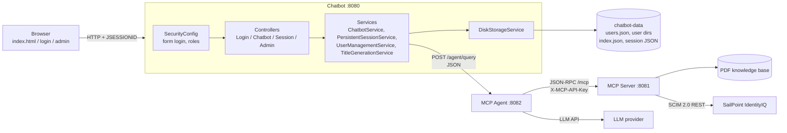
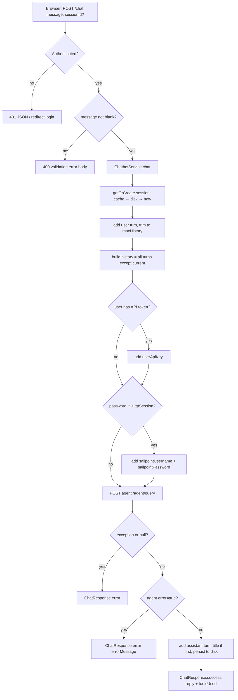
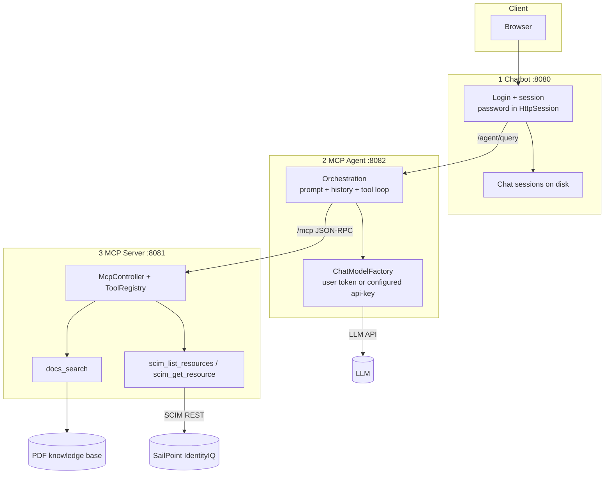

# Component 1 — IAM Chatbot (`chatbot`, port 8080)

User-facing web application of the Enterprise IAM Assistant. It authenticates users, serves the chat UI, keeps conversation history on disk, and delegates every question to the **MCP Agent** (Component 2), which in turn uses the **MCP Server** (Component 3) to reach the IAM knowledge base and SailPoint.

```
Browser ──► Chatbot (8080) ──► MCP Agent (8082) ──► MCP Server (8081) ──► PDF knowledge base / SailPoint IdentityIQ (SCIM 2.0)
```

> Everything below describes what the code in this module does today. Items that do not exist (rate limiting, retries, tracing, …) are listed explicitly as gaps in [section 12](#12-missing-information--frequently-overlooked-areas).

---

## Table of contents
1. [Component overview](#1-component-overview)
2. [Architecture and design](#2-architecture-and-design)
3. [Source code structure](#3-source-code-structure)
4. [Class-by-class explanation](#4-class-by-class-explanation)
5. [End-to-end code flow](#5-end-to-end-code-flow)
6. [Communication flow between components](#6-communication-flow-between-components)
7. [Chatbot → AI Agent → MCP Server flow](#7-chatbot--ai-agent--mcp-server-flow)
8. [APIs and interfaces](#8-apis-and-interfaces)
9. [Configuration and environment setup](#9-configuration-and-environment-setup)
10. [Logging, monitoring and troubleshooting](#10-logging-monitoring-and-troubleshooting)
11. [Security considerations](#11-security-considerations)
12. [Missing information / frequently overlooked areas](#12-missing-information--frequently-overlooked-areas)
13. [Overall architecture summary](#13-overall-architecture-summary)

---

## 1. Component overview

### Purpose
The chatbot is the only component end users touch. It gives employees, managers, application owners, administrators and auditors a browser chat window for IAM questions and live SailPoint lookups.

### Business responsibilities
- Let people ask IAM questions in natural language and see answers (rendered Markdown).
- Keep each user's past conversations (list, reopen, rename, delete).
- Let an administrator create, edit, disable and delete chatbot users.
- Let each user optionally store their own LLM API token.

### Technical responsibilities
- Form login (username/password) with Spring Security, BCrypt-hashed passwords, roles `ADMIN` / `USER`.
- Hold the login password in the server-side HTTP session so the user's own SailPoint credentials can be forwarded with each chat call.
- Maintain per-user conversation sessions (in-memory cache + JSON files on disk).
- Call the MCP Agent over REST (`POST /agent/query`) and map its response to the UI.
- Serve the static single-page UI (`index.html`) and Thymeleaf pages (`login.html`, `admin.html`).

### Key functionalities
| Area | Functionality |
|---|---|
| Authentication | Form login `POST /login`, logout `GET /logout`, 8 h HTTP session, default admin bootstrap |
| Chat | `POST /chat` → agent; history sent to agent; answer + tools used returned |
| Sessions | create / list / open / rename / delete, auto title from first message, FIFO cap per user |
| User admin | CRUD of users at `/admin` + `/api/admin/users` (ADMIN only) |
| Token | `GET/PUT /api/user/token` — optional per-user LLM API token |
| Credential forwarding | login password → `sailpointUsername` / `sailpointPassword` in the agent payload |

### Dependencies
| Dependency | Kind | Used for |
|---|---|---|
| MCP Agent (`mcp.agent.url`, default `http://localhost:8082`) | Runtime, required | Answers every chat message |
| Local disk (`chatbot.storage.path`) | Runtime, required | `users.json`, per-user session files |
| Spring Boot 3.2.5, Java 21 | Build/runtime | Web, Security, Validation, Actuator, WebFlux (`WebClient`), Thymeleaf |
| MCP Server, SailPoint | Indirect | Reached only through the agent |

---

## 2. Architecture and design

### High-level architecture



### Internal architecture
Classic layered Spring MVC application:

1. **Web layer** — `LoginController`, `ChatbotController`, `SessionController`, `AdminController` (+ `GlobalExceptionHandler`).
2. **Security layer** — `SecurityConfig` with a `DaoAuthenticationProvider` backed by `UserManagementService` and `BCryptPasswordEncoder`.
3. **Service layer** — `ChatbotService` (orchestrates a chat turn), `PersistentSessionService` (session lifecycle), `UserManagementService` (users + tokens), `TitleGenerationService`.
4. **Persistence layer** — `DiskStorageService` (JSON files, atomic writes). No database.
5. **Model** — plain POJOs/records for chat, sessions, persisted files and user accounts.

### Design patterns
| Pattern | Where |
|---|---|
| Layered architecture / MVC | controllers → services → storage |
| Façade/Orchestrator | `ChatbotService.chat()` coordinates sessions, token lookup, agent call, persistence |
| Cache-aside | `PersistentSessionService.memoryCache` over `DiskStorageService` |
| Repository-like file store | `DiskStorageService` (per-user directory, `index.json` + `<sessionId>.json`) |
| Atomic write (write temp + move) | `DiskStorageService.writeAtomic`, `UserManagementService.saveUsersToDisk` |
| Static factory | `ChatResponse.success()` / `ChatResponse.error()` |
| Centralised exception handling | `GlobalExceptionHandler` (`@RestControllerAdvice`) |
| Typed configuration | `ChatbotProperties` record (`@ConfigurationProperties`) |
| Strategy (Spring Security) | `DaoAuthenticationProvider` + `UserDetailsService` |

### Deployment architecture and hosting
- Single executable Spring Boot JAR (`mvn package`), embedded Tomcat on **8080**, context path `/`.
- One instance only in practice: sessions (`HttpSession`) and the conversation cache are **in JVM memory**, and files are written to **local disk**; there is no shared store.
- Must run where it can reach the agent (`MCP_AGENT_URL`) and has a writable `CHATBOT_STORAGE_PATH` and `LOG_DIR`.
- Start order for the full solution: MCP Server (8081) → MCP Agent (8082) → Chatbot (8080).

---

## 3. Source code structure

```
chatbot/
├── pom.xml                                   Maven build (Spring Boot 3.2.5, Java 21)
├── src/main/java/com/iam/assistant/chatbot/
│   ├── ChatbotApplication.java               Entry point (@SpringBootApplication, @ConfigurationPropertiesScan)
│   ├── config/
│   │   ├── AppConfig.java                    WebClient.Builder (5 MB codec limit), BCrypt PasswordEncoder
│   │   ├── ChatbotProperties.java            chatbot.* typed settings (session, auth, storage)
│   │   └── SecurityConfig.java               Auth provider, filter chain, CSRF exceptions, 401 vs redirect
│   ├── controller/
│   │   ├── LoginController.java              /login, /logout (manual authentication, stores password in session)
│   │   ├── ChatbotController.java            POST /chat, DELETE /chat/{sessionId}
│   │   ├── SessionController.java            /me, /api/user/token, /sessions…
│   │   └── AdminController.java              /admin, /api/admin/users…
│   ├── service/
│   │   ├── ChatbotService.java               One chat turn: history → agent → persist
│   │   ├── PersistentSessionService.java     Session cache + disk + FIFO cap
│   │   ├── DiskStorageService.java           JSON file I/O
│   │   ├── UserManagementService.java        UserDetailsService + users.json + API tokens
│   │   ├── TitleGenerationService.java       Title from first message
│   │   └── SessionService.java               @Deprecated in-memory sessions (unused)
│   ├── model/                                ChatRequest, ChatResponse, ChatSession, Persisted*, Session*, UserIndex, UserAccount
│   └── exception/                            GlobalExceptionHandler, StorageException
└── src/main/resources/
    ├── application.yml                       Port, agent URL, session/auth/storage, logging
    ├── templates/login.html                  Thymeleaf login form (CSRF token)
    ├── templates/admin.html                  Thymeleaf admin UI (CSRF via meta tags)
    └── static/index.html                     Single-page chat UI (vanilla JS, Markdown rendering)
```

### How the modules interact
`Controllers` receive HTTP and the authenticated principal → call `Services` → services call `DiskStorageService` for files or `WebClient` for the agent. `SecurityConfig` wraps everything: unauthenticated calls never reach controllers (except `/login`, `/error`). `UserManagementService` is used twice: by Spring Security (to authenticate) and by controllers/`ChatbotService` (users, tokens).

### Runtime data layout (`chatbot.storage.path`)
```
<storage>/users.json                 all accounts (BCrypt hash, role, apiToken, enabled)
<storage>/<sanitised-userId>/index.json          session summaries, newest first
<storage>/<sanitised-userId>/<sessionId>.json    full conversation
```
User ids are sanitised to `[a-zA-Z0-9_\-.]` for directory names.

---

## 4. Class-by-class explanation

### 4.1 Bootstrap and configuration

#### `ChatbotApplication`
- **Purpose:** application entry point.
- **Key method:** `main(String[])` → `SpringApplication.run`.
- **Annotations:** `@SpringBootApplication`, `@ConfigurationPropertiesScan` (registers `ChatbotProperties`).
- **Invoked:** JVM start.

#### `AppConfig` (`@Configuration`)
- **Purpose:** shared beans.
- **Beans:** `WebClient.Builder webClientBuilder()` (default codecs, `maxInMemorySize` 5 MB — caps the size of an agent response body); `PasswordEncoder passwordEncoder()` → `BCryptPasswordEncoder`.
- **Also:** `@EnableConfigurationProperties(ChatbotProperties.class)`.
- **Used by:** `ChatbotService` (builder), `SecurityConfig` / `UserManagementService` (encoder).
- **Note:** no connect/read timeout is configured on this builder (see §12).

#### `ChatbotProperties` (record, prefix `chatbot`)
- **Purpose:** typed config. Nested records: `SessionProperties(maxHistory=30, ttlMinutes=60, maxSessionsPerUser=20)`, `AuthProperties(adminUsername, adminPassword)`, `StorageProperties(path)`.
- **Used by:** `PersistentSessionService`, `UserManagementService`, `DiskStorageService`.

#### `SecurityConfig` (`@Configuration @EnableWebSecurity`)
- **Purpose:** authentication and authorisation rules.
- **Beans:** `DaoAuthenticationProvider` (user details from `UserManagementService`, BCrypt), `AuthenticationManager` (`ProviderManager`), `SecurityFilterChain`.
- **Rules:** `/login`, `/error` public; `/admin`, `/admin/**`, `/api/admin/**` need role `ADMIN`; everything else authenticated. Spring's `formLogin` and `logout` are **disabled** (handled by `LoginController`).
- **CSRF:** enabled, but ignored for `/chat`, `/chat/**`, `/sessions`, `/sessions/**`, `/api/user/**`.
- **Entry point:** AJAX requests (`X-Requested-With: XMLHttpRequest` or `Accept: application/json`) get `401` + `{"error":true,"errorMessage":"Please log in to continue."}`; other requests are redirected to `/login?required=true`.

### 4.2 Controllers

#### `LoginController`
- **Purpose:** login/logout.
- **Constant:** `SESSION_PASSWORD_ATTR = "iam.sailpoint.password"`.
- **Methods:**
  - `GET /login` → view `login`.
  - `POST /login(username, password)` → builds `UsernamePasswordAuthenticationToken(username.trim().toLowerCase(), password)`, authenticates via `AuthenticationManager`, stores the `SecurityContext` in the HTTP session, **stores the plaintext password in the session attribute**, redirects to `/`. On `AuthenticationException` → `/login?error=true`.
  - `GET /logout` → clears context, invalidates session, expires `JSESSIONID`, redirects to `/login?logout=true`.
- **Depends on:** `AuthenticationManager`.
- **Invoked:** login form submit; "Sign out" link.

#### `ChatbotController` (`/chat`)
- **Purpose:** REST endpoint for chat.
- **Methods:**
  - `POST /chat` — input `ChatRequest` (`@Valid`), `HttpSession`, `Authentication`; output `ChatResponse` (always HTTP 200 — errors are in the body). Reads the password from the session via `sailPointPassword()` (null if absent/empty) and calls `ChatbotService.chat(request, auth.getName(), password)`.
  - `DELETE /chat/{sessionId}` — deletes that user's session (204).
- **Depends on:** `ChatbotService`, `PersistentSessionService`, `LoginController.SESSION_PASSWORD_ATTR`.
- **Invoked:** UI `fetch('/chat')`.

#### `SessionController`
- **Purpose:** identity, token and session-history endpoints (all use `auth.getName()`, so users only see their own data).
- **Methods:** `GET /me` → `{username, role}`; `GET /api/user/token` → `{apiToken}`; `PUT /api/user/token` (`{apiToken}`) → stores trimmed token; `GET /sessions` → `List<SessionSummary>`; `POST /sessions` → new `SessionSummary`; `GET /sessions/{id}` → `SessionDetail` or 404; `PATCH /sessions/{id}` (`{title}`, max 100 chars, non-empty) → `{title}` / 400 / 404; `DELETE /sessions/{id}` → 204.
- **Depends on:** `PersistentSessionService`, `UserManagementService`.

#### `AdminController` (ADMIN only)
- **Purpose:** user administration and the admin page.
- **Methods:** `GET /admin` → view `admin`; `GET /api/admin/users` → list of `{username, role, apiToken, enabled}`; `POST /api/admin/users` (`username`, `password`, optional `role` default `USER`) → created user / 400 (blank fields or duplicate); `PUT /api/admin/users/{username}` (`password`, `role`, `enabled`, `apiToken`) → updated user / 404; `DELETE /api/admin/users/{username}` → 204 / 400 (cannot delete yourself) / 404; also deletes that user's session data.
- **Depends on:** `UserManagementService`, `PersistentSessionService`.
- **Note:** the user DTO returns each user's stored `apiToken` in clear text to admins.

### 4.3 Services

#### `ChatbotService` — the chat orchestrator
- **Purpose:** executes one chat turn.
- **Key method:** `ChatResponse chat(ChatRequest request, String userId, String sailPointPassword)`.
- **Steps:** get/create session → add user turn → build `history` (all turns except the just-added one, as `{role, content}` maps) → build payload (`query`, `sessionId`, `history`, optional `userApiKey` only if the user has a non-blank token, optional `sailpointUsername` = `userId` + `sailpointPassword` only if a password is available) → `POST {mcp.agent.url}/agent/query` via `WebClient` (blocking) → read `error`/`errorMessage`/`answer`/`toolsUsed` → add assistant turn, set title on first message, persist → `ChatResponse.success`; on any exception `ChatResponse.error(ex.getMessage())`.
- **Depends on:** `WebClient.Builder`, `PersistentSessionService`, `UserManagementService`, `@Value("${mcp.agent.url}")`.
- **Invoked by:** `ChatbotController.chat`.

#### `PersistentSessionService`
- **Purpose:** session lifecycle with memory cache + disk.
- **Key methods:** `getOrCreate(userId, sessionId)` (evict expired → cache → disk → create new); `createSession(userId)` (synchronized; FIFO eviction of the oldest summary when `maxSessionsPerUser` reached; writes index + empty session file); `persist(userId, session)` (writes session file + updates index entry, re-sorted newest first; swallows `StorageException` with a warning); `setTitleIfAbsent`; `listSessions`; `getSessionDetail`; `renameSession`; `deleteSession`; `deleteAllSessionsForUser`; private `evictExpired()` (drops cache entries idle > `ttlMinutes`), `fromPersisted`/`toPersisted`.
- **Cache key:** `userId:sessionId`. Cache is a `ConcurrentHashMap`.
- **Depends on:** `DiskStorageService`, `TitleGenerationService`, `ChatbotProperties`.
- **Invoked by:** `ChatbotService`, `ChatbotController`, `SessionController`, `AdminController`.

#### `DiskStorageService`
- **Purpose:** JSON file persistence.
- **Key methods:** `ensureUserDirectory`, `loadSession` (null if missing/unreadable), `saveSession`, `deleteSession`, `loadIndex` (empty index if unreadable), `saveIndex`, `deleteUserData` (recursive delete), `resolveSessionPath`, `resolveIndexPath`; private `sanitize`, `writeAtomic` (`.tmp` file then `ATOMIC_MOVE`, fallback to normal move).
- **Throws:** `StorageException` on write/init failure.
- **Depends on:** `ChatbotProperties`, `ObjectMapper`. Constructor creates the storage root and fails startup if it cannot.

#### `UserManagementService` (`UserDetailsService`)
- **Purpose:** account store and Spring Security user source.
- **Key methods:** `init()` (`@PostConstruct`: create dir, load `users.json`, create default admin if empty); `loadUserByUsername`; `listUsers`; `createUser` (BCrypt hash, rejects duplicates with `IllegalArgumentException`); `updateUser` (optional new password, role, enabled); `deleteUser`; `updateToken`; `getUserToken` (empty string if none); `userExists`.
- **Storage:** `users.json` in memory (`ConcurrentHashMap`) + atomic file rewrite after each change.
- **Depends on:** `ChatbotProperties`, `PasswordEncoder`, `ObjectMapper`.
- **Invoked by:** Spring Security at login, `ChatbotService`, `SessionController`, `AdminController`, `SecurityConfig`.

#### `TitleGenerationService`
- **Purpose:** derive a session title from the first message.
- **Method:** `generateTitle(String)` — collapses whitespace, strips characters other than word chars/space/`-?!`, truncates to 60 chars at a word boundary, falls back to `"New Chat"`.
- **Invoked by:** `PersistentSessionService.setTitleIfAbsent`.

#### `SessionService` (`@Deprecated`)
- **Purpose:** old in-memory-only session store. Not injected anywhere; kept for reference only. Still registered as a bean because of `@Service`.

### 4.4 Models

| Class | Purpose | Notes |
|---|---|---|
| `ChatRequest` | Body of `POST /chat` | `message` (`@NotBlank`), optional `sessionId` |
| `ChatResponse` | Body returned by `POST /chat` | fields `sessionId`, `reply`, `toolsUsed`, `error`, `errorMessage`; factories `success`, `error` (reply becomes `"Sorry, I encountered an error: …"`); `NON_NULL` JSON |
| `ChatSession` | In-memory conversation | `sessionId`, `userId`, `title`, `history` (`Turn(role, content, timestamp)` record), `lastActivity`; `addUserTurn` trims history to `maxHistory` entries; `addAssistantTurn`; `isFirstUserMessage` |
| `PersistedSession` | Session file format | id, user, title, timestamps, `List<PersistedMessage>` |
| `PersistedMessage` | One stored message | role, content, timestamp |
| `SessionSummary` | Index entry / list item | id, title, created, lastActivity, messageCount |
| `SessionDetail` | Response of `GET /sessions/{id}` | summary + messages |
| `UserIndex` | `index.json` format | userId + `List<SessionSummary>` |
| `UserAccount` | Account in `users.json` | username, `passwordHash`, role (`ADMIN`/`USER`), `apiToken`, enabled |

### 4.5 Exceptions

#### `StorageException` (runtime)
Raised by `DiskStorageService` (init/write failures).

#### `GlobalExceptionHandler` (`@RestControllerAdvice`)
| Exception | HTTP | Body |
|---|---|---|
| `StorageException` | 500 | `{error:true, errorMessage:"Session history is temporarily unavailable. Your current chat is still active."}` |
| `NoSuchElementException` | 404 | empty |
| `MethodArgumentNotValidException` | 400 | `{error:true, errorMessage:"<field>: <message>"}` |
| `ConstraintViolationException` | 400 | `{error:true, errorMessage:<message>}` |

### 4.6 Front-end resources
- `static/index.html` — single-page UI: sidebar of sessions, chat window, Markdown rendering, "My Token" modal, calls `/me`, `/sessions`, `/sessions/{id}`, `/chat`, `/api/user/token`; `safeFetch` redirects to `/login` on 401.
- `templates/login.html` — form posting to `/login` with the CSRF hidden field; shows error/logout/required alerts.
- `templates/admin.html` — user table and create/edit dialog calling `/api/admin/users`, sending the CSRF token header.

---

## 5. End-to-end code flow

### 5.1 Startup
1. `ChatbotApplication.main` boots Spring; `ChatbotProperties` bound from `application.yml`.
2. `DiskStorageService` constructor creates the storage root (startup fails with `StorageException` if impossible).
3. `UserManagementService.init()` loads `users.json`; if no users, creates the default admin from `chatbot.auth.*`.
4. Security filter chain active.

### 5.2 Login
1. Browser requests `/` → unauthenticated → redirect to `/login?required=true` (or 401 for AJAX).
2. `POST /login` (CSRF token required) → `LoginController.processLogin` → `AuthenticationManager` → `DaoAuthenticationProvider` → `UserManagementService.loadUserByUsername` + BCrypt compare. Disabled accounts are rejected.
3. Success: context + password stored in `HttpSession`, redirect `/`. Failure: `/login?error=true`.

### 5.3 One chat message



**Decision points and error handling**
- Authentication / 401 vs redirect: `SecurityConfig` entry point.
- Validation: `@NotBlank message` → `GlobalExceptionHandler` → 400.
- Session lookup: unknown/foreign `sessionId` silently creates a new session (the user id is part of the cache key and directory, so other users' sessions are not reachable).
- Token: an empty token is **not** an error — `userApiKey` is simply omitted and the agent uses its configured key.
- Agent failure (network, timeout, 4xx/5xx): caught by `catch (Exception)` in `ChatbotService` → `ChatResponse.error(ex.getMessage())` (HTTP 200 with `error:true`).
- Agent-reported failure (`error:true`): its `errorMessage` is passed to the user.
- Persistence failure after a successful answer: `PersistentSessionService.persist` logs a warning and the answer is still returned.
- On any error the user turn already added stays in the in-memory session (it is not persisted unless a later turn succeeds).

---

## 6. Communication flow between components

| From → To | Protocol | Endpoint | Auth |
|---|---|---|---|
| Browser → Chatbot | HTTP, `JSESSIONID` cookie | `/login`, `/chat`, `/sessions`, … | form login + session; CSRF on form/admin calls |
| Chatbot → Agent | HTTP/REST, JSON | `POST {mcp.agent.url}/agent/query` | **none** (no key/header is sent) |
| Agent → MCP Server | HTTP, **MCP-style JSON-RPC 2.0** | `POST {mcp.server.url}/mcp` | `X-MCP-API-Key` (service key) |
| Agent → MCP Server (SailPoint calls) | same + header | `X-SailPoint-Authorization: Basic …` | user's SailPoint login, if forwarded |
| MCP Server → SailPoint | HTTPS/HTTP REST (SCIM 2.0) | `/identityiq/scim/v2/*` | Basic with user's login, else configured Basic or Bearer |
| Agent → LLM | HTTPS (Spring AI) | provider API | user token if supplied, else `llm.providers.<name>.api-key` |

### Chatbot → Agent payload
```json
{
  "query": "list all roles",
  "sessionId": "2f0c…",
  "history": [ {"role":"user","content":"…"}, {"role":"assistant","content":"…"} ],
  "userApiKey": "optional",
  "sailpointUsername": "optional",
  "sailpointPassword": "optional"
}
```
`userApiKey` and the two `sailpoint*` fields are omitted entirely when not available.

### Agent → Chatbot response
```json
{ "answer": "…", "sessionId": "2f0c…", "toolsUsed": ["scim_list_resources"], "error": false }
```
or `{ "error": true, "errorMessage": "…", "answer": "I encountered an error: …" }`.

### Chatbot → Browser response (`ChatResponse`)
```json
{ "sessionId":"2f0c…", "reply":"…", "toolsUsed":["docs_search"], "error":false }
```

---

## 7. Chatbot → AI Agent → MCP Server flow

### 7.1 Chatbot layer
- **Input:** the UI sends `POST /chat {message, sessionId?}` with the session cookie.
- **Validation/preprocessing:** Bean Validation (`message` not blank); the principal name (lower-cased at login) becomes `userId`.
- **Session management:** `PersistentSessionService.getOrCreate` → cache/disk/new; history capped at `chatbot.session.max-history` (30) entries; idle cache entries evicted after `ttl-minutes` (60) (disk copy remains); at most `max-sessions-per-user` (20) sessions per user, oldest deleted first.
- **Context sent:** previous turns (not the current one) as `history`; the current one as `query`.

### 7.2 AI Agent layer (Component 2, for context)
1. `AgentController` `POST /agent/query` → `AgentOrchestrationService.process`.
2. Fetches tool definitions from the MCP Server (`tools/list`) and wraps each as a Spring AI `ToolCallback` (`McpToolCallbackFactory`) carrying the optional user credentials.
3. Builds a chat model for the configured provider (`ChatModelFactory`): the caller's `userApiKey` if present, otherwise `llm.providers.<provider>.api-key`.
4. Builds the prompt: system prompt (`default-system-prompt.txt` or `llm.system-prompt-path`) + history messages + the query.
5. Spring AI runs the tool-calling loop; each tool call goes through `McpToolCallback.call` → `McpClientService.callTool` → MCP Server, limited by `llm.max-tool-iterations` (default 12, enforced by `ToolRun`).
6. Returns the final text as `answer`, plus `toolsUsed`. LLM HTTP 401/403 is reported as "The API token was rejected…"; other failures as "LLM API error: …".

Tools available: `docs_search`, `scim_list_resources`, `scim_get_resource`. The prompt tells the model to page through all results when asked for "all" and not to abbreviate lists.

### 7.3 MCP Server layer (Component 3, for context)
- `ApiKeyAuthFilter` checks `X-MCP-API-Key` (constant-time compare) on every request.
- `McpController` (`POST /mcp`) supports `tools/list` and `tools/call`; anything else returns JSON-RPC "method not found".
- `ToolRegistry` collects every `McpTool` bean at startup (discovery); `tools/call` looks the tool up by name and executes it, converting exceptions to an error result.
- For `tools/call` the controller puts `X-SailPoint-Authorization` into `SailPointCredentialContext` (thread-local, cleared in `finally`).
- SailPoint tools call `SailPointScimClient`, which uses the forwarded Basic credentials, or else `sailpoint.scim` config (BASIC or BEARER). Results are compacted (`schemas`/`meta` removed), capped (`max-results`, `max-response-chars`) and returned as text content.

### 7.4 Complete trace

```mermaid
sequenceDiagram
    autonumber
    actor User
    participant UI as Browser UI
    participant CB as Chatbot :8080
    participant Disk as Chatbot storage
    participant AG as MCP Agent :8082
    participant LLM as LLM provider
    participant MS as MCP Server :8081
    participant SP as SailPoint SCIM

    User->>UI: types question
    UI->>CB: POST /chat {message, sessionId} + JSESSIONID
    CB->>CB: authenticate, validate, get session (cache/disk)
    CB->>AG: POST /agent/query {query, history, [userApiKey], [sailpointUsername/Password]}
    AG->>MS: POST /mcp tools/list (X-MCP-API-Key)
    MS-->>AG: tool definitions
    AG->>LLM: system prompt + history + query + tools
    LLM-->>AG: tool_use scim_list_resources {resource, filter…}
    AG->>MS: POST /mcp tools/call (X-MCP-API-Key, X-SailPoint-Authorization)
    MS->>MS: ToolRegistry → tool.execute; credential context set
    MS->>SP: GET /identityiq/scim/v2/<Resource>?filter…&count (Basic/Bearer)
    SP-->>MS: SCIM JSON list
    MS->>MS: compact, cap size, format
    MS-->>AG: result.content[0].text
    AG->>LLM: tool result
    LLM-->>AG: final answer (may loop with more tool calls)
    AG-->>CB: {answer, toolsUsed, error:false}
    CB->>Disk: persist session + index
    CB-->>UI: {reply, sessionId, toolsUsed}
    UI-->>User: rendered Markdown answer
```

Return path in words: SailPoint → MCP Server (formats) → Agent (feeds the LLM; LLM writes the answer) → Chatbot (stores the exchange) → Browser (renders).

---

## 8. APIs and interfaces

### Endpoints
| Method & path | Role | Request | Response |
|---|---|---|---|
| `GET /login` | public | — | login page |
| `POST /login` | public (CSRF) | form `username`, `password` | redirect `/` or `/login?error=true` |
| `GET /logout` | any | — | redirect `/login?logout=true` |
| `GET /` | user | — | `index.html` |
| `GET /me` | user | — | `{"username","role"}` |
| `POST /chat` | user | `{"message","sessionId?"}` | `ChatResponse` |
| `DELETE /chat/{sessionId}` | user | — | 204 |
| `GET /sessions` | user | — | `[SessionSummary]` |
| `POST /sessions` | user | — | `SessionSummary` |
| `GET /sessions/{id}` | user | — | `SessionDetail` / 404 |
| `PATCH /sessions/{id}` | user | `{"title"}` | `{"title"}` / 400 / 404 |
| `DELETE /sessions/{id}` | user | — | 204 |
| `GET /api/user/token` | user | — | `{"apiToken"}` |
| `PUT /api/user/token` | user | `{"apiToken"}` | `{"apiToken"}` |
| `GET /admin` | ADMIN | — | admin page |
| `GET /api/admin/users` | ADMIN | — | `[{username, role, apiToken, enabled}]` |
| `POST /api/admin/users` | ADMIN (CSRF) | `{"username","password","role?"}` | user / 400 |
| `PUT /api/admin/users/{username}` | ADMIN (CSRF) | `{"password?","role?","enabled?","apiToken?"}` | user / 404 |
| `DELETE /api/admin/users/{username}` | ADMIN (CSRF) | — | 204 / 400 / 404 |
| `GET /actuator/health`, `/actuator/info` | **see note** | — | actuator JSON |

> Actuator is exposed (`management.endpoints.web.exposure.include: health,info`) but `SecurityConfig` has no matching rule, so these URLs fall under "any other request → authenticated".

### Example
```http
POST /chat
Content-Type: application/json

{"message":"Which roles exist in SailPoint?","sessionId":"2f0c…"}
```
```json
{"sessionId":"2f0c…","reply":"There are 12 roles: …","toolsUsed":["scim_list_resources"],"error":false}
```
Error example (agent unreachable):
```json
{"sessionId":"2f0c…","reply":"Sorry, I encountered an error: Connection refused","error":true,"errorMessage":"Connection refused"}
```

### Error codes
| Situation | Result |
|---|---|
| Not logged in (AJAX) | 401 `{"error":true,"errorMessage":"Please log in to continue."}` |
| Not logged in (browser) | 302 → `/login?required=true` |
| Not ADMIN on admin URLs | 403 (Spring Security default) |
| Blank `message` | 400 `{"error":true,"errorMessage":"message: …"}` |
| Admin create with blank/duplicate user | 400 `{"error":"…"}` |
| Admin deletes self | 400 `{"error":"You cannot delete your own account"}` |
| Unknown session / user | 404 |
| Storage failure | 500 (handler message above) |
| Agent/LLM/MCP/SailPoint failure | 200 with `error:true` and a message |

### External integration points
Only the **MCP Agent** (`POST /agent/query`, `GET /agent/health` exists on the agent but is not used by the chatbot). SailPoint and the LLM are reached indirectly.

---

## 9. Configuration and environment setup

### `application.yml` (key settings)
| Key | Default | Meaning |
|---|---|---|
| `server.port` | 8080 | HTTP port |
| `server.servlet.session.timeout` | 8h | HTTP session lifetime (also lifetime of the stored password) |
| `mcp.agent.url` | `${MCP_AGENT_URL:http://localhost:8082}` | Agent base URL |
| `mcp.agent.connect-timeout` / `read-timeout` | 5s / 120s | **declared but not read by any code** (see §12) |
| `chatbot.session.max-history` | 30 | Turns kept per session |
| `chatbot.session.ttl-minutes` | 60 | Cache idle eviction |
| `chatbot.session.max-sessions-per-user` | 20 | FIFO cap |
| `chatbot.auth.admin-username` / `admin-password` | `${CHATBOT_ADMIN_USERNAME}` / `${CHATBOT_ADMIN_PASSWORD}` (built-in fallbacks exist) | Bootstrap admin, only created when `users.json` is empty |
| `chatbot.storage.path` | `${CHATBOT_STORAGE_PATH:./data/chatbot}` | Data directory |
| `logging.file.name` | `${LOG_DIR:./logs}/iam-chatbot.log` | Log file |
| `management.endpoints.web.exposure.include` | `health,info` | Actuator |

### Environment variables
`MCP_AGENT_URL`, `CHATBOT_ADMIN_USERNAME`, `CHATBOT_ADMIN_PASSWORD`, `CHATBOT_STORAGE_PATH`, `LOG_DIR`, `LOG_MAX_FILE_SIZE` (10MB), `LOG_MAX_HISTORY` (30), `LOG_TOTAL_SIZE_CAP` (1GB).

### Secrets management
There is no vault integration. Secrets live in: `users.json` (BCrypt hashes **and per-user API tokens in clear text**), the admin bootstrap password (env var or built-in fallback), and the HTTP session (login password, memory only). Set `CHATBOT_ADMIN_*` via the environment, restrict file permissions on the storage directory, and change the bootstrap admin password immediately.

### Build and run
```bash
cd chatbot
mvn clean package                       # Java 21, Maven 3.9+
export MCP_AGENT_URL=http://localhost:8082
export CHATBOT_ADMIN_PASSWORD='<strong password>'
java -jar target/chatbot-1.0.0.jar
# open http://localhost:8080  (log in, create users at /admin)
```
Start the MCP Server and MCP Agent first (see their READMEs).

---

## 10. Logging, monitoring and troubleshooting

### Logging
- SLF4J/Logback via Spring Boot. Level `INFO` for `com.iam.assistant`.
- Console and rolling file `${LOG_DIR:./logs}/iam-chatbot.log` (10 MB per file, 30 days, 1 GB total).
- Notable lines: `Chat [user=…, session=…]: <message text>` (the full user message is logged), `Created user`, `Updated API token for user`, FIFO eviction, storage warnings.
- The login password and API tokens are **not** logged by the chatbot.

### Monitoring
Only Spring Actuator `health` and `info`. No metrics endpoint, no alerting, no tracing.

### Common issues
| Symptom | Likely cause | Fix |
|---|---|---|
| "Sorry, I encountered an error: Connection refused" | Agent not running / wrong `MCP_AGENT_URL` | Start agent, check URL |
| Reply says API token rejected | User token invalid | Update via "My Token" or clear it to use the agent default |
| "No API token for provider…" | No user token **and** no `api-key` for the chosen provider on the agent | Set `llm.providers.<name>.api-key` on the agent or add a user token |
| SailPoint calls return 401 | Login password differs from SailPoint password, or server default creds wrong | Make chatbot credentials match SailPoint, or log in again (password is in the session only) |
| SailPoint answered with server credentials after restart | Session lost on restart → no password forwarded | Log in again |
| Redirected to login repeatedly | Session expired (8 h) or server restarted | Log in |
| "Session history is temporarily unavailable" | Disk full / permission on storage path | Fix path permissions/space |
| Chat hangs for a long time | No client timeout on the agent call | Check agent/LLM; see §12 |
| Cannot log in with default admin | `users.json` already exists with other users | Use existing credentials or remove the file (loses all users) |

---

## 11. Security considerations

### Authentication and authorisation
- Form login against local accounts; BCrypt hashes; roles `ADMIN`/`USER`; disabled flag respected.
- URL rules: admin paths need `ADMIN`; all others need login. Data isolation is by `auth.getName()` in every session/token call.
- Session cookie `JSESSIONID`, 8 h timeout, invalidated on logout.

### Token and credential handling
- **LLM API token:** per user, stored in clear text in `users.json`, shown to the owner in the UI and to admins in `/api/admin/users`, sent to the agent in the JSON body only when set.
- **SailPoint login password:** kept in the `HttpSession` (memory), forwarded in every chat request body to the agent; the agent turns it into a Basic header for the MCP Server. It is never written to disk by the chatbot. It only works if the chatbot password equals the user's SailPoint password, because chatbot logins are validated locally, not against SailPoint.
- **Hard-coded defaults:** the agent and MCP Server `application.yml` files contain hard-coded fallback keys/credentials, and this module has built-in admin credential fallbacks. These should move to environment variables or a secret store.

### Data protection and transport
- No TLS is configured anywhere in this module; all hops default to plain `http://`. The password and tokens therefore cross the network unencrypted unless TLS is terminated in front. Put HTTPS on the browser→chatbot hop and on chatbot→agent→MCP Server→SailPoint when hosts differ.
- Conversation files and `users.json` are plain text on disk (no encryption at rest).

### Service-to-service security
- Chatbot → Agent: **no authentication**. Anyone who can reach port 8082 can call `/agent/query`, including supplying their own SailPoint credentials.
- Agent → MCP Server: shared API key header.
- CSRF is disabled for `/chat`, `/sessions`, `/api/user/**` (JSON endpoints), enabled for login and admin calls.
- Frontend renders model output as Markdown into the DOM; treat tool/LLM output as untrusted.

---

## 12. Missing information / frequently overlooked areas

| Area | Current state in this component |
|---|---|
| **Error handling flow** | Chat errors are returned as HTTP 200 with `error:true`; the user turn remains in the in-memory session even when the call failed, so it will be sent as an unanswered turn in later `history`. |
| **Retry / resiliency** | None. No retry, circuit breaker or bulkhead on the agent call. |
| **Timeout handling** | `mcp.agent.connect-timeout`/`read-timeout` exist in `application.yml` but **nothing reads them**; the `WebClient` has no timeouts and `.block()` has none. A stuck agent holds a Tomcat thread. Only the agent's own LLM/MCP timeouts apply downstream. |
| **Scalability** | Single instance only: in-memory `HttpSession`, in-memory session cache, local-disk files, `synchronized` session creation, whole-file rewrite of `users.json`/`index.json`. Blocking calls per request. |
| **Load balancing** | Not supported as built (needs sticky sessions at minimum and shared storage; session state and stored passwords are per instance). |
| **Caching** | Only the session cache with 60 min idle eviction; no HTTP caching, no response caching. |
| **Rate limiting** | None — per-user, per-IP or per-login. Brute-force login attempts are not throttled or locked out. |
| **Failover** | None. If the agent is down chat fails; if the chatbot restarts all HTTP sessions (and forwarded passwords) are lost. |
| **Data persistence / storage flow** | JSON files via atomic temp-file move; no locking between processes, no backup, no schema versioning; unreadable session files are silently treated as missing. FIFO cap deletes the oldest conversation without warning. |
| **Observability / tracing** | No metrics, correlation ids or distributed tracing; user messages are logged at INFO; there is no audit log of logins, admin actions or SailPoint access by user. |
| **Security gaps** | Plaintext API tokens in `users.json` and in admin API responses; plaintext password in session and over HTTP; unauthenticated chatbot→agent hop; no TLS; no login throttling; no password policy; default admin fallback credentials; admin can set any user's token; unauthenticated actuator not explicitly governed; `SessionService` deprecated bean still registered; chatbot password must match SailPoint password for per-user lookups to work. |
| **Other** | `ChatbotController.DELETE /chat/{sessionId}` duplicates `DELETE /sessions/{id}`. `ChatSession` history trimming drops the oldest entries (a user/assistant pair can be split). History grows the agent payload (no token budgeting). |

---

## 13. Overall architecture summary



**End-to-end in one pass**
1. The user logs in to the **chatbot**; the credentials are checked against the chatbot's own user file and the password is kept in the server-side session.
2. Each message goes to `POST /chat`; the chatbot loads or creates the conversation, adds the history, and calls the **agent** with the question, optional LLM token and optional SailPoint login.
3. The **agent** lists the MCP Server's tools, builds the prompt, and lets the LLM call tools (up to a budget). Each call is a JSON-RPC `tools/call` to the **MCP Server** with the service API key and, when available, the user's SailPoint Basic credentials.
4. The **MCP Server** runs the tool: `docs_search` against the indexed PDFs, or a SCIM read against SailPoint using the user's credentials (falling back to its own Basic/Bearer configuration). Output is compacted and size-capped.
5. The result returns to the agent, the LLM writes the final answer, and the agent returns `{answer, toolsUsed}`.
6. The chatbot stores the exchange on disk, titles the conversation if it is the first message, and returns `{reply, toolsUsed}` to the browser, which renders it.

**What is read-only:** all tools only read. The chatbot's own data (users, tokens, conversations) is the only data this system writes.
