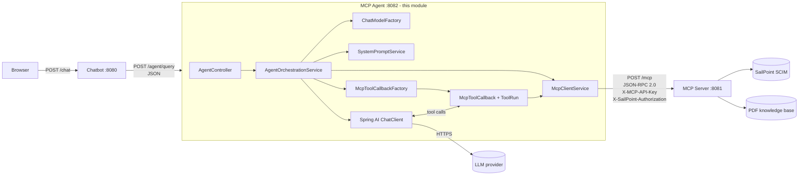
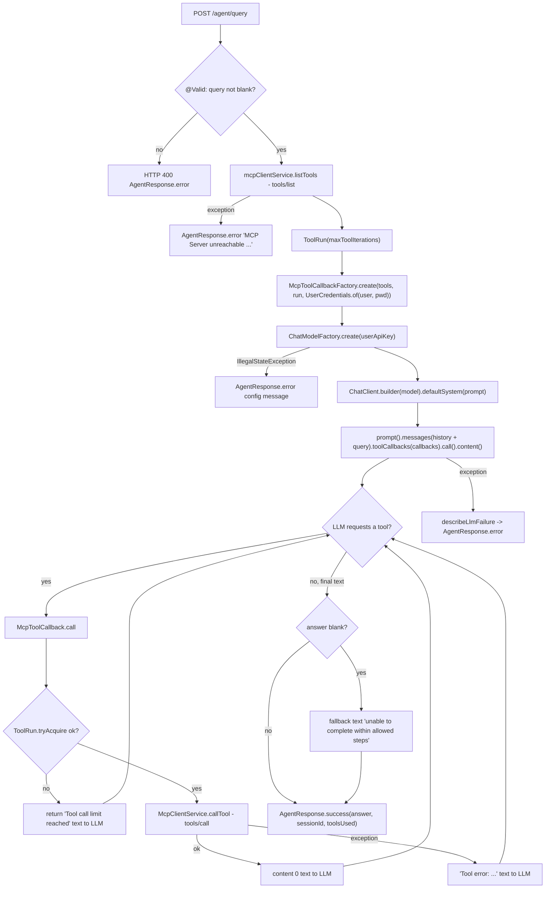
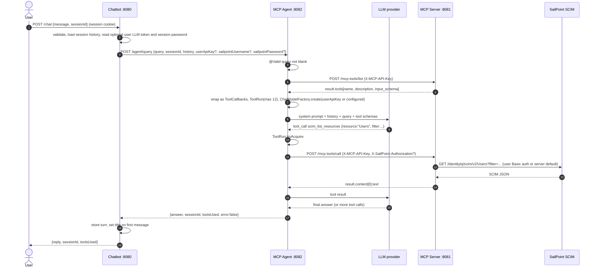
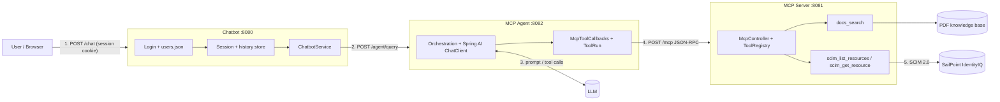

# MCP Agent (AI Agent) — Component 2 of the IAM Assistant

The intelligence tier of the IAM Assistant. It receives a natural-language question from the Chatbot, hands an LLM the tools exposed by the MCP Server, lets the LLM call those tools until it can answer, and returns the final answer to the Chatbot.

LLM access is done with **Spring AI 1.0.3** (`ChatClient`). The agent has no hand-written LLM HTTP code and no hand-written tool-calling loop; the only hand-written network code is the JSON-RPC client for the MCP Server.

> Everything below describes what the code in this module does today. Things that are **absent** are listed explicitly in [section 12](#12-missing-information--frequently-overlooked-areas).

## Contents

1. [Component overview](#1-component-overview)
2. [Architecture and design](#2-architecture-and-design)
3. [Source code structure](#3-source-code-structure)
4. [Class-by-class explanation](#4-class-by-class-explanation)
5. [End-to-end code flow](#5-end-to-end-code-flow)
6. [Communication flow between components](#6-communication-flow-between-components)
7. [Chatbot → AI Agent → MCP Server flow](#7-chatbot--ai-agent--mcp-server-flow)
8. [APIs and interfaces](#8-apis-and-interfaces)
9. [Configuration and environment setup](#9-configuration-and-environment-setup)
10. [Logging, monitoring and troubleshooting](#10-logging-monitoring-and-troubleshooting)
11. [Security considerations](#11-security-considerations)
12. [Missing information / frequently overlooked areas](#12-missing-information--frequently-overlooked-areas)
13. [Overall architecture summary (all three components)](#13-overall-architecture-summary-all-three-components)

---

## 1. Component overview

### Purpose
The agent is the orchestration layer between the user-facing Chatbot (port 8080) and the tool-owning MCP Server (port 8081). It turns a question plus conversation history into an answer by combining an LLM with live tools.

### Business responsibilities
- Answer IAM / IDM / IGA questions from the knowledge base (`docs_search`) and read-only live SailPoint data (SCIM tools), following the rules in the system prompt.
- Make sure the assistant never claims to change anything in SailPoint (the prompt says it is read-only; the tools exposed by the MCP Server are read-only).
- Let each Chatbot user use their own LLM token and their own SailPoint login, falling back to configured defaults.

### Technical responsibilities
- Discover tools from the MCP Server on every query (`tools/list`) and wrap each one as a Spring AI `ToolCallback`.
- Build a `ChatModel` for the configured provider **per request** (so a per-user token can be used).
- Build the prompt (system prompt + history + question) and run it through Spring AI `ChatClient`, which executes the tool-calling loop.
- Execute each tool call on the MCP Server (`tools/call`), enforcing a per-query call budget.
- Convert failures into a user-safe `AgentResponse` (`error:true`).
- Serve/reload the system prompt.

### Key functionalities
| Functionality | Where |
|---|---|
| `POST /agent/query` | `AgentController` |
| Orchestration (tools → model → loop → answer) | `AgentOrchestrationService` |
| 11 LLM providers, per-request model | `ChatModelFactory` |
| MCP JSON-RPC 2.0 client | `McpClientService` |
| Tool budget (max calls per query) | `ToolRun`, `McpToolCallback` |
| Per-user SailPoint credentials forwarding | `UserCredentials`, `McpClientService` |
| System prompt load / hot reload | `SystemPromptService`, `AdminController` |

### Dependencies
| Dependency | Type | Used for |
|---|---|---|
| Chatbot (8080) | caller | sends `POST /agent/query` |
| MCP Server (8081) | downstream | `POST /mcp` JSON-RPC (`tools/list`, `tools/call`), header `X-MCP-API-Key` |
| LLM provider | external | chat completions through Spring AI (Anthropic, OpenAI-compatible, Ollama, Azure OpenAI, Mistral, DeepSeek, MiniMax, ZhiPu, Bedrock, Vertex AI) |
| SailPoint IdentityIQ | indirect | reached only via the MCP Server |
| Java 21, Spring Boot 3.4.13, Spring AI 1.0.3 | runtime | see `pom.xml` |

---

## 2. Architecture and design

### High-level architecture



### Internal architecture
Layered, stateless request processing:

1. **Web layer** – `AgentController`, `AdminController`, `GlobalExceptionHandler`.
2. **Orchestration layer** – `AgentOrchestrationService` (the only place that knows the whole flow).
3. **LLM layer** – `ChatModelFactory` (provider switch) and Spring AI `ChatClient`.
4. **MCP client layer** – `McpClientService`, `McpToolCallbackFactory`, `McpToolCallback`, `ToolRun`.
5. **Configuration** – `LlmProperties`, `ProviderProperties`, `McpClientProperties`, `AppConfig`.

The agent holds **no conversation state**: history arrives in each request and is not stored.

### Design patterns
| Pattern | Where |
|---|---|
| Factory | `ChatModelFactory.create(...)`, `McpToolCallbackFactory.create(...)`, `AgentResponse.success/error`, `UserCredentials.of` |
| Adapter | `McpToolCallback` adapts an MCP tool to Spring AI's `ToolCallback` |
| Strategy (by configuration) | provider selection by `llm.provider` in `ChatModelFactory` |
| Facade | `AgentOrchestrationService` hides tool discovery, model, prompt, loop |
| Builder | `ConversationTurn.Builder`, Spring AI builders |
| Per-request context object | `ToolRun` (budget + tools used), `UserCredentials` |
| Externalised configuration | `@ConfigurationProperties` classes |

### Deployment architecture and hosting
- Plain Spring Boot executable JAR (`spring-boot-maven-plugin`), embedded Tomcat, port **8082**.
- No Dockerfile, Kubernetes manifests, or CI files exist in this module; hosting is whatever runs `java -jar`.
- Needs network access to: the MCP Server (`MCP_SERVER_URL`), and the LLM endpoint (for Ollama a local daemon).
- Stateless, so multiple instances could run behind a load balancer; nothing in the repository configures that (see section 12).

---

## 3. Source code structure

```
mcp-agent/
├── pom.xml                                   Spring Boot 3.4.13, Spring AI BOM 1.0.3, Java 21
├── README.md                                 this file
├── logs/                                     runtime log output (iam-agent.log, rolled files)
├── target/                                   build output
└── src/
    ├── main/
    │   ├── java/com/iam/assistant/agent/
    │   │   ├── McpAgentApplication.java              Spring Boot entry point
    │   │   ├── config/
    │   │   │   ├── AppConfig.java                    mcpWebClient bean; enables LlmProperties
    │   │   │   ├── LlmProperties.java                prefix "llm"
    │   │   │   ├── ProviderProperties.java           one provider's settings
    │   │   │   └── McpClientProperties.java          prefix "mcp.server"
    │   │   ├── controller/
    │   │   │   ├── AgentController.java              /agent/query, /agent/health
    │   │   │   └── AdminController.java              /admin/prompt/reload, /admin/prompt/info
    │   │   ├── exception/GlobalExceptionHandler.java validation + catch-all handler
    │   │   ├── llm/ChatModelFactory.java             builds a Spring AI ChatModel per request
    │   │   ├── model/
    │   │   │   ├── AgentRequest.java                 inbound payload
    │   │   │   ├── AgentResponse.java                outbound payload
    │   │   │   ├── ConversationTurn.java             one history message
    │   │   │   └── UserCredentials.java              SailPoint login (masked toString)
    │   │   └── service/
    │   │       ├── AgentOrchestrationService.java    core flow
    │   │       ├── McpClientService.java             JSON-RPC client for the MCP Server
    │   │       ├── McpToolCallbackFactory.java       MCP tool definition -> ToolCallback
    │   │       ├── McpToolCallback.java              executes one tool via MCP
    │   │       ├── SystemPromptService.java          loads/reloads the system prompt
    │   │       └── ToolRun.java                      per-query tool budget
    │   └── resources/
    │       ├── application.yml                       all configuration
    │       └── default-system-prompt.txt             the system prompt (classpath default)
    └── test/java/com/iam/assistant/agent/llm/ChatModelFactoryTest.java
```

### How modules interact
`AgentController` → `AgentOrchestrationService` → (`McpClientService.listTools` → `McpToolCallbackFactory` → `McpToolCallback`s) and (`ChatModelFactory` → `ChatClient`). During the Spring AI loop each `McpToolCallback.call` → `ToolRun.tryAcquire` → `McpClientService.callTool` → MCP Server. `AdminController` talks only to `SystemPromptService`.

### Configuration files
| File | Purpose |
|---|---|
| `application.yml` | port, `llm.*` (provider, 11 provider blocks, prompt path, tool budget, trust-all-certs), `mcp.server.*`, actuator exposure, logging |
| `default-system-prompt.txt` | classpath fallback system prompt |
| `pom.xml` | dependencies: web, validation, actuator, webflux, spring-ai-client-chat and the 10 provider starters (anthropic, openai, ollama, azure-openai, mistral-ai, deepseek, minimax, zhipuai, bedrock-converse, vertex-ai-gemini), jackson |

---

## 4. Class-by-class explanation

### `McpAgentApplication`
- **Purpose:** Spring Boot entry point; `@SpringBootApplication` + `@ConfigurationPropertiesScan` (registers `McpClientProperties`).
- **Key method:** `main(String[])`.
- **Invoked:** at JVM start.

### `config.AppConfig`
- **Purpose:** declares the `mcpWebClient` bean and enables `LlmProperties`.
- **Key method:** `mcpWebClient()` → `WebClient` with base URL = `mcp.server.url`, default headers `X-MCP-API-Key: <mcp.server.api-key>` and `Content-Type: application/json`, Reactor Netty connector with connect timeout (`mcp.server.connect-timeout`, 10 s) and a `ReadTimeoutHandler` (`mcp.server.read-timeout`, 60 s).
- **Dependencies:** `McpClientProperties`. **Used by:** `McpClientService` (qualifier `mcpWebClient`).

### `config.LlmProperties` (`llm.*`)
- **Purpose:** provider name (`provider`), `systemPromptPath`, `maxToolIterations` (default 12), `trustAllCerts` (default false), and `providers` map.
- **Key method:** `provider(String name)` – returns the block or throws `IllegalStateException("No settings found under llm.providers.<name>")`.
- **Used by:** `ChatModelFactory`, `SystemPromptService`, `AgentOrchestrationService`.

### `config.ProviderProperties`
- **Purpose:** settings of one provider: `apiUrl`, `apiKey`, `completionsPath`, `model`, `maxTokens` (4096 default in class), `readTimeoutSeconds` (120), `region` (Bedrock), `projectId` and `location` (Vertex).
- **Used by:** `ChatModelFactory`.

### `config.McpClientProperties` (`mcp.server.*`)
- **Purpose:** `url` and `apiKey` (both `@NotBlank`, validated at startup), `connectTimeout` (10 s), `readTimeout` (60 s).
- **Used by:** `AppConfig`.

### `controller.AgentController`
- **Purpose:** REST entry point for the Chatbot.
- **Methods:** `POST /agent/query` (`@Valid @RequestBody AgentRequest` → `ResponseEntity<AgentResponse>`; always HTTP 200 for orchestrated results, including `error:true`); `GET /agent/health` → `"MCP Agent is healthy"`.
- **Dependencies:** `AgentOrchestrationService`. **Invoked:** by the Chatbot for every chat message. Logs `session=<id>` only.

### `controller.AdminController`
- **Purpose:** inspect and hot-reload the system prompt.
- **Methods:** `POST /admin/prompt/reload` → `{status, source, promptLength, reloadedAt}`; `GET /admin/prompt/info` → `{source, promptLength, lastLoaded}`.
- **Dependencies:** `SystemPromptService`. **Note:** unauthenticated (section 11).

### `exception.GlobalExceptionHandler`
- **Purpose:** `@RestControllerAdvice` returning `AgentResponse` on errors.
- **Methods:** `handleValidation(MethodArgumentNotValidException)` → HTTP 400, message = joined field errors (e.g. `query must not be blank`); `handleGeneral(Exception)` → HTTP 500 with `ex.getMessage()`, stack trace logged.

### `llm.ChatModelFactory`
- **Purpose:** builds a Spring AI `ChatModel` for the configured provider on every request (Spring AI otherwise fixes the key at startup). Construction does no network I/O.
- **Key methods:**
  - `getProviderName()` → lower-cased `llm.provider`.
  - `create(String userApiKey)` → `ChatModel`. Blank key = `null`. Switch on provider:

| Provider (`llm.provider`) | Class built | Token use |
|---|---|---|
| `anthropic` | `AnthropicChatModel` | key sent as `x-api-key` **and** `Authorization: Bearer` (the gateway needs Bearer); `api-url`, `model`, `max-tokens` required |
| `openai`, `opencode` | `OpenAiChatModel` (OpenAI-compatible; `completions-path` default `/v1/chat/completions`) | key |
| `ollama` | `OllamaChatModel` | none (token ignored) |
| `azure-openai` | `AzureOpenAiChatModel` (`api-url` = resource endpoint, `model` = deployment) | key |
| `mistral` | `MistralAiChatModel` (default URL/model if blank) | key |
| `deepseek` | `DeepSeekChatModel` | key |
| `minimax` | `MiniMaxChatModel` | key |
| `zhipuai` | `ZhiPuAiChatModel` | key |
| `bedrock` | `BedrockProxyChatModel` | `accessKeyId:secretAccessKey[:sessionToken]`; blank → configured `api-key` in same format → default AWS credential chain; malformed → `IllegalStateException` |
| `vertex-ai` | `VertexAiGeminiChatModel` | none: Google Application Default Credentials; needs `project-id`, `location` |

  - Helpers: `keyOf` (user key, else `providers.<p>.api-key`, else `IllegalStateException("No API token for provider ...")`), `require`, `orDefault`, `restClient(Duration)` (JDK `HttpClient`, 10 s connect timeout, per-provider read timeout, optional trust-all `SSLContext` when `llm.trust-all-certs=true`).
- **Unknown provider:** `IllegalStateException("Unsupported llm.provider ...")`.
- **Invoked by:** `AgentOrchestrationService.process`.

### `model.AgentRequest` (`@JsonIgnoreProperties(ignoreUnknown=true)`)
| Field | Required | Meaning |
|---|---|---|
| `query` | yes (`@NotBlank`) | the question |
| `history` | no | list of `ConversationTurn` |
| `sessionId` | no | echoed back |
| `userApiKey` | no | the user's LLM token; if absent the provider's configured `api-key` is used |
| `sailpointUsername`, `sailpointPassword` | no | user's SailPoint login; if absent the MCP Server uses its own configured SailPoint auth |

### `model.AgentResponse` (`NON_NULL`)
- Fields `answer`, `sessionId`, `toolsUsed`, `error`, `errorMessage`. Factories: `success(answer, sessionId, toolsUsed)` and `error(message)` (answer becomes `"I encountered an error: <message>"`). Private constructor.

### `model.ConversationTurn`
- `role` (`user` | `assistant`) and `content`; builder. Used to rebuild history.

### `model.UserCredentials` (record)
- **Purpose:** carries the SailPoint login for one request.
- **Methods:** `of(username, password)` → `null` unless both are present; `toBasicAuthorization()` → `"Basic " + base64(user:password)` (UTF-8); `toString()` masks the password.
- **Invoked:** built in `AgentOrchestrationService`, used in `McpClientService.callMcp`.

### `service.AgentOrchestrationService`
- **Purpose:** the core flow (see section 5).
- **Key methods:** `process(AgentRequest)` → `AgentResponse`; `buildMessages` (history → `UserMessage`/`AssistantMessage`, then the query); `describeLlmFailure` (maps HTTP 401/403 → "API token was rejected… update it via My Token or clear it to use the agent default", other 4xx/5xx → `LLM API error: <first 300 chars>`, anything else → generic message); `rootMessage` (walks the cause chain, ≤2000 chars, to find the status).
- **Dependencies:** `ChatModelFactory`, `SystemPromptService`, `McpClientService`, `McpToolCallbackFactory`, `LlmProperties`.
- **Invoked:** by `AgentController.query`.

### `service.McpClientService`
- **Purpose:** MCP JSON-RPC 2.0 client over the `mcpWebClient`.
- **Key methods:** `initialize()` (sends `initialize` with protocol version `2024-11-05`; **defined but not called by the request path**), `listTools()` → `List<Map>` from `result.tools`, `callTool(name, arguments, UserCredentials)` → `result` node, private `callMcp(body, credentials)` (POST `/mcp`; adds `X-SailPoint-Authorization` only when credentials are non-null), `buildRequest` (JSON-RPC envelope with an incrementing `AtomicInteger` id).
- **Errors:** any exception from the HTTP call is wrapped in `McpCommunicationException("MCP Server unreachable: …")` (nested static class).
- **Invoked:** `listTools` per query by the orchestrator; `callTool` by `McpToolCallback`.

### `service.McpToolCallbackFactory`
- **Purpose:** converts each MCP tool entry (`name`, `description`, `input_schema`) into a Spring AI `ToolDefinition` and a `McpToolCallback`; missing schema → `{"type":"object","properties":{}}`.
- **Method:** `create(List<Map<String,Object>> mcpTools, ToolRun run, UserCredentials credentials)`.

### `service.McpToolCallback` (implements `ToolCallback`)
- **Purpose:** executes one MCP tool when Spring AI asks.
- **Key method:** `call(String toolInput)`: `run.tryAcquire(name)` → if the budget is spent returns the text *"Tool call limit reached. Using only the information already retrieved…"* without calling the server; otherwise parses the JSON arguments (blank → `{}`), calls `mcpClientService.callTool`, returns `result.content[0].text` (or the pretty-printed result). Any exception → the string `"Tool error: <message>"` returned **to the LLM** (not thrown).

### `service.SystemPromptService`
- **Purpose:** holds the system prompt in volatile fields.
- **Methods:** `load()` (`@PostConstruct`), `reload()`, `getPrompt()`, `getSource()`, `getLastLoaded()`. Order: `llm.system-prompt-path` (any Spring resource location, e.g. `file:...`), on failure warn and fall back to `classpath:default-system-prompt.txt`; if that fails, startup fails with `IllegalStateException`.

### `service.ToolRun`
- **Purpose:** per-query budget and audit list. `tryAcquire(toolName)` increments an `AtomicInteger`; returns false once `> maxCalls` (attempts over the limit are not recorded). `getToolsUsed()` returns a copy.

### `ChatModelFactoryTest`
- JUnit 5 test scaffolding that builds an `LlmProperties` for every provider. The test methods in the file are **commented out**, so no automated tests currently run.

---

## 5. End-to-end code flow

### Flowchart of `AgentOrchestrationService.process`



### Step by step
1. **Entry:** `AgentController.query` validates the body (`query` not blank) and logs the session id.
2. **Tool discovery:** `listTools()` posts `tools/list` to the MCP Server on **every** query (no cache).
3. **Per-request objects:** a `ToolRun` (budget `llm.max-tool-iterations`, default 12) and callbacks created with `UserCredentials.of(sailpointUsername, sailpointPassword)` (null unless both provided).
4. **Model:** `ChatModelFactory.create(userApiKey)`; configuration problems come back as `AgentResponse.error(<message>)` immediately.
5. **Prompt:** `ChatClient` with `defaultSystem(systemPromptService.getPrompt())`; messages = history (role `user` → `UserMessage`, anything else → `AssistantMessage`) + the new query.
6. **Loop (inside Spring AI):** model → tool call(s) → `McpToolCallback.call` → MCP Server → result text back to model → … until the model answers in text.
7. **Result:** blank answer is replaced by *"I was unable to complete the search within the allowed number of steps. Please try a more specific query."*; otherwise trimmed answer returned with `toolsUsed` from `ToolRun`.

### Decision points, validation, transformation
- Validation: `@NotBlank query`; `@NotBlank` `mcp.server.url`/`api-key` at startup.
- Transformation: history → Spring AI messages; MCP `input_schema` → Spring AI `ToolDefinition`; MCP `content[0].text` → plain string for the LLM; `UserCredentials` → Basic header.
- Error handling summary:

| Failure | Result |
|---|---|
| Blank `query` | HTTP 400 `AgentResponse.error("query must not be blank")` |
| MCP Server unreachable / HTTP error on `tools/list` | HTTP 200 `error:true`, message `MCP Server unreachable: …` |
| Unknown provider / missing token / missing setting | HTTP 200 `error:true` with the configuration message |
| LLM HTTP 401/403 | `error:true`, "API token was rejected by the AI service (HTTP n)…" |
| Other LLM HTTP 4xx/5xx | `error:true`, `LLM API error: <≤300 chars>` |
| Other exception | `error:true`, "The AI service encountered an unexpected error. Please try again." (stack trace in log) |
| Tool call fails (network, bad JSON) | LLM sees `Tool error: …` and decides what to say; request itself succeeds |
| Tool budget exceeded | LLM sees the limit message; no MCP call |
| Uncaught exception in the controller path | HTTP 500 via `GlobalExceptionHandler` |

---

## 6. Communication flow between components

| Hop | Protocol | Format | Auth |
|---|---|---|---|
| Chatbot → Agent | HTTP/1.1 REST (`POST /agent/query`) | JSON | **none** on the agent |
| Agent → MCP Server | HTTP, **MCP-style JSON-RPC 2.0** over `POST /mcp` | JSON-RPC envelope | header `X-MCP-API-Key` (shared secret); optional `X-SailPoint-Authorization: Basic …` |
| Agent → LLM | HTTPS via Spring AI | provider-specific | user token or configured key (Bedrock: AWS keys, Vertex: ADC) |
| MCP Server → SailPoint | HTTP, SCIM 2.0 | JSON | forwarded Basic credentials, else server default (Basic/Bearer) |

### Chatbot → Agent request
```json
{
  "query": "List active users",
  "sessionId": "abc-123",
  "history": [{"role":"user","content":"hi"},{"role":"assistant","content":"Hello"}],
  "userApiKey": "<optional LLM token>",
  "sailpointUsername": "<optional login name>",
  "sailpointPassword": "<optional login password>"
}
```
The Chatbot omits `userApiKey` when the user has none and omits the SailPoint pair when the session has no password.

### Agent → MCP Server
`tools/list`:
```json
{"jsonrpc":"2.0","id":1,"method":"tools/list","params":{}}
```
`tools/call`:
```json
{"jsonrpc":"2.0","id":2,"method":"tools/call",
 "params":{"name":"scim_list_resources","arguments":{"resource":"Users","filter":"active eq true"}}}
```
Response: `{"jsonrpc":"2.0","id":2,"result":{"content":[{"type":"text","text":"..."}],"isError":false}}`. The agent returns `content[0].text` to the LLM.

### Authentication, authorization, security mechanisms
- Agent → MCP Server: static shared API key, set once on the `WebClient`.
- SailPoint identity propagation: `UserCredentials.toBasicAuthorization()` → header `X-SailPoint-Authorization` on **`tools/call` only** (never on `tools/list`). The MCP Server uses it for that tool call and falls back to its own configured auth when absent.
- The agent itself performs **no** authentication or authorization of callers.

---

## 7. Chatbot → AI Agent → MCP Server flow

### Chatbot layer (as seen from this module)
- The Chatbot authenticates the user (form login, session cookie), keeps chat sessions/history per user, and on `POST /chat` builds the agent payload above. It stores the login password in the server-side HTTP session only for forwarding to SailPoint.
- It does not call the LLM itself; it calls `POST {mcp.agent.url}/agent/query` and maps `error`/`answer`/`toolsUsed` to its own response.

### AI Agent layer
- **Invocation:** `AgentController.query`.
- **Orchestration:** section 5.
- **Prompt construction:** the system prompt text (see `default-system-prompt.txt`: persona, tool list, rules for `docs_search`, SCIM resource mapping, how to call/read results, error behaviour, "not available" actions, no secrets, concise style) is the Spring AI *system* message; history and the new question are *user/assistant* messages. There is no truncation, summarisation or token counting of history.
- **Tool selection:** done entirely by the LLM from the tool schemas the MCP Server advertises; the agent only enforces the call budget.
- **Execution:** each requested tool → `McpToolCallback.call` → `tools/call`.

### MCP Server layer
- **Connect:** `POST {mcp.server.url}/mcp` with `X-MCP-API-Key`.
- **Discovery:** `tools/list` returns the registered tools (currently `docs_search`, `scim_list_resources`, `scim_get_resource`).
- **Routing/execution:** `tools/call` is dispatched by name in `ToolRegistry`; results are `ToolCallResult` (`content[]`, `isError`). The SailPoint tools read the optional credentials header for that call and query SailPoint SCIM (`/identityiq/scim/v2/...`).
- **Return path:** result text → agent → LLM → final answer → Chatbot.

### Complete trace



---

## 8. APIs and interfaces

### Endpoints
| Method & path | Purpose | Auth |
|---|---|---|
| `POST /agent/query` | process a question | none |
| `GET /agent/health` | liveness text | none |
| `POST /admin/prompt/reload` | reload system prompt | none |
| `GET /admin/prompt/info` | prompt source/length/time | none |
| `GET /actuator/health`, `GET /actuator/info` | Spring Boot Actuator (only these two are exposed) | none |

### `POST /agent/query`
Request: see section 6. Success response:
```json
{"answer":"Here are the active users ...","sessionId":"abc-123","toolsUsed":["scim_list_resources"],"error":false}
```
Error response (HTTP 200 for orchestration errors):
```json
{"answer":"I encountered an error: MCP Server unreachable: ...","error":true,"errorMessage":"MCP Server unreachable: ..."}
```
Validation failure → HTTP 400 `{"answer":"I encountered an error: query must not be blank","error":true,"errorMessage":"query must not be blank"}`. Unexpected exception → HTTP 500 with the same shape.

### `POST /admin/prompt/reload`
```json
{"status":"ok","source":"classpath:default-system-prompt.txt","promptLength":4521,"reloadedAt":"2026-11-23T10:15:30Z"}
```
(values illustrative).

### Error codes
| Code | When |
|---|---|
| 200 + `error:true` | MCP unreachable, provider/token/config problem, LLM HTTP error, unexpected AI error |
| 400 | bean-validation failure |
| 500 | exception escaping the controller |

### External integration points
LLM providers (section 1), MCP Server `/mcp`, and optionally a custom prompt file/URL (`LLM_SYSTEM_PROMPT_PATH`).

---

## 9. Configuration and environment setup

### Key settings (`application.yml`)
| Property | Env var | Default / note |
|---|---|---|
| `server.port` | – | `8082` |
| `llm.provider` | `LLM_PROVIDER` | `anthropic`; one of `anthropic, openai, opencode, ollama, azure-openai, mistral, deepseek, minimax, zhipuai, bedrock, vertex-ai` |
| `llm.system-prompt-path` | `LLM_SYSTEM_PROMPT_PATH` | blank = classpath default |
| `llm.max-tool-iterations` | `LLM_MAX_TOOL_ITERATIONS` | `12` |
| `llm.trust-all-certs` | `LLM_TRUST_ALL_CERTS` | `false` (disables TLS chain verification for LLM calls when true) |
| `llm.providers.anthropic.*` | `ANTHROPIC_API_URL`, `ANTHROPIC_API_KEY`, `ANTHROPIC_MODEL`, `ANTHROPIC_MAX_TOKENS`, `ANTHROPIC_READ_TIMEOUT_SECONDS` | proxy URL, model `claude-sonnet-4-6`, max tokens 8192, read timeout 120 s |
| `llm.providers.openai.*` | `OPENAI_API_URL`, `OPENAI_COMPLETIONS_PATH`, `OPENAI_API_KEY`, `OPENAI_MODEL`, `OPENAI_MAX_TOKENS`, `OPENAI_READ_TIMEOUT_SECONDS` | |
| `llm.providers.opencode.*` | `OPENCODE_API_URL`, `OPENCODE_API_PATH`, `OPENCODE_API_KEY`, `OPENCODE_MODEL`, `OPENCODE_MAX_TOKENS`, `OPENCODE_READ_TIMEOUT_SECONDS` | |
| `llm.providers.ollama.*` | `OLLAMA_API_URL`, `OLLAMA_MODEL`, `OLLAMA_MAX_TOKENS`, `OLLAMA_READ_TIMEOUT_SECONDS` | read timeout 600 s |
| `llm.providers.azure-openai.*` | `AZURE_OPENAI_ENDPOINT`, `AZURE_OPENAI_API_KEY`, `AZURE_OPENAI_DEPLOYMENT`, `AZURE_OPENAI_MAX_TOKENS` | |
| `llm.providers.mistral/deepseek/minimax/zhipuai.*` | `MISTRAL_*`, `DEEPSEEK_*`, `MINIMAX_*`, `ZHIPUAI_*` (`_API_URL`, `_API_KEY`, `_MODEL`, `_MAX_TOKENS`) | |
| `llm.providers.bedrock.*` | `AWS_REGION`, `BEDROCK_CREDENTIALS` (`accessKeyId:secret[:session]`), `BEDROCK_MODEL`, `BEDROCK_MAX_TOKENS` | |
| `llm.providers.vertex-ai.*` | `VERTEX_PROJECT_ID`, `VERTEX_LOCATION`, `VERTEX_MODEL`, `VERTEX_MAX_TOKENS` | uses Google ADC |
| `mcp.server.url` | `MCP_SERVER_URL` | `http://localhost:8081` |
| `mcp.server.api-key` | `MCP_SERVER_API_KEY` | **no default; startup fails if unset**; must equal the MCP Server's key |
| `mcp.server.connect-timeout` / `read-timeout` | – | `10s` / `60s` |
| `logging.file.name` | `LOG_DIR` | `./logs/iam-agent.log` |
| rolling policy | `LOG_MAX_FILE_SIZE`, `LOG_MAX_HISTORY`, `LOG_TOTAL_SIZE_CAP` | 10MB / 30 / 1GB |

### Token fallback rule
`userApiKey` from the Chatbot wins; if blank/absent the provider's `llm.providers.<name>.api-key` is used; if both are empty, a clear error is returned (Ollama and Vertex AI need no token).

### Secrets management
- Only environment variables / external config are supported; there is no vault integration.
- **Risk:** `application.yml` currently contains a **hard-coded fallback value for the Anthropic API key** (`ANTHROPIC_API_KEY` default). It should be removed from the file (default empty), rotated, and supplied via environment or a secret store.

### Build and run
```bash
cd mcp-agent
mvn clean package
export MCP_SERVER_API_KEY=<same as MCP Server>
export ANTHROPIC_API_KEY=<token>          # or LLM_PROVIDER=ollama etc.
java -jar target/mcp-agent-1.0.0.jar
```
Start order: MCP Server (8081) → MCP Agent (8082) → Chatbot (8080). Health: `GET http://localhost:8082/agent/health`.

---

## 10. Logging, monitoring and troubleshooting

### Logging
- Spring Boot default Logback; pattern is Boot's default. File: `${LOG_DIR:./logs}/iam-agent.log` with size/time rolling (`max-file-size`, `max-history`, `total-size-cap`). Level `com.iam.assistant=INFO`.
- Logged at INFO: each query text (`Agent processing query [provider=…]: <query>` — user text is in the log), tools used, executed tool names, prompt load source. Warnings: auth failures, prompt fallback. Errors: LLM API errors, MCP failures, orchestration failures. Tool arguments, passwords and tokens are not logged by this module; `UserCredentials.toString()` is masked.

### Monitoring
Only Actuator `health` and `info`. No metrics endpoint, alerting, or dashboards are configured.

### Troubleshooting
| Symptom | Cause | Resolution |
|---|---|---|
| App fails at startup with `mcp.server.api-key` / placeholder `MCP_SERVER_API_KEY` | env var not set | set `MCP_SERVER_API_KEY` |
| `MCP Server unreachable: …` | MCP Server down, wrong `MCP_SERVER_URL`, 401 from wrong API key, timeout >60 s | check MCP Server health/logs; keys must match |
| "API token was rejected by the AI service (HTTP 401/403)" | bad user token or bad configured key | fix the token (Chatbot ⚙ My Token) or clear it to use the default |
| `No API token for provider '<p>'` | no user token and empty `api-key` | set `<PROVIDER>_API_KEY` |
| `Unsupported llm.provider` / `llm.providers.<p>.<field> is required` | misconfiguration | fix `LLM_PROVIDER` or the provider block |
| Bedrock "token must be accessKeyId:secretAccessKey…" | wrong format | use `AKIA…:secret[:session]` |
| Answer says "unable to complete within the allowed number of steps" | empty model answer, often after the tool budget (12) was used | narrow the question; raise `LLM_MAX_TOOL_ITERATIONS` |
| Lists cut with "…" | LLM output limit | raise `*_MAX_TOKENS`; prompt tells the model not to abbreviate |
| Prompt change not visible | prompt cached at startup | `POST /admin/prompt/reload` |
| TLS handshake errors to an internal LLM gateway | cert not in truststore | import the cert; `LLM_TRUST_ALL_CERTS=true` is a last resort |

---

## 11. Security considerations

- **Inbound:** `/agent/**`, `/admin/**` and actuator have **no authentication** (no Spring Security dependency). Anyone who can reach port 8082 can query the agent, spend LLM tokens, send arbitrary `userApiKey`/SailPoint credentials, and reload the prompt. Restrict by network (bind/firewall to the Chatbot host) or add authentication.
- **Agent → MCP Server:** shared static key (`X-MCP-API-Key`), plain HTTP by default (`http://localhost:8081`). The same hop carries the user's SailPoint password (Base64 Basic, which is encoding not encryption) in `X-SailPoint-Authorization`; use TLS if hosts differ.
- **Token handling:** the user's LLM token is used only to build that request's model; it is not stored or logged. SailPoint credentials live in a request-scoped `UserCredentials` and are not logged.
- **Data protection:** the agent persists nothing. Prompts, history, tool results and the question are sent to the chosen LLM provider (third-party data egress; evaluate per provider). Queries are written to the log in clear text.
- **Prompt-injection:** the system prompt tells the model to treat tool results as data and not to act on them; the tools are read-only. This is a prompt-level control only.
- **TLS to LLMs:** normal verification unless `llm.trust-all-certs=true`, which disables chain verification for all LLM calls.
- **Secrets in config:** hard-coded fallback Anthropic key in `application.yml` (see section 9).

---

## 12. Missing information / frequently overlooked areas

| Area | Current state in this module |
|---|---|
| **Error handling** | Described in section 5. JSON-RPC `error` objects from the MCP Server are **not inspected**: `callTool` returns `response.path("result")`, so an `error` reply yields an empty/missing result rather than a clear message; tool-level errors from the server arrive as `isError` content text and are passed to the LLM as-is. |
| **Retries / resiliency** | None implemented for MCP calls. LLM-call retries, if any, are whatever Spring AI's model builders apply by default; nothing is configured here. No circuit breaker or fallback provider. A failed `tools/list` fails the whole query. |
| **Timeouts** | MCP: connect 10 s, read 60 s (per call). LLM: per-provider `read-timeout-seconds` (120 s; Ollama 600 s), JDK HTTP connect 10 s. There is **no overall deadline** for one query: up to 12 tool calls × (MCP 60 s + LLM 120 s) can accumulate, and the Chatbot's own timeout may fire first. |
| **Scalability** | Stateless, so horizontally scalable in principle. Each query does a blocking `tools/list`, blocking tool calls (`.block()`), and builds a new `ChatModel`/HTTP client — thread-per-request on Tomcat. No concurrency limits. |
| **Load balancing** | Not configured. Chatbot points to a single `mcp.agent.url`; agent to a single `mcp.server.url`. |
| **Caching** | None: tool list fetched every query; model rebuilt every query; no response caching. System prompt is cached in memory until reloaded. |
| **Rate limiting** | None (inbound or to the LLM). A caller can drive unbounded LLM spend; only the per-query tool budget limits tool calls. |
| **Failover** | None (single LLM provider per instance, single MCP Server). |
| **Data persistence** | None; conversation history is owned by the Chatbot and sent every request. Only log files are written. |
| **Observability / tracing** | Logs and two Actuator endpoints only. No correlation/trace id is passed to the MCP Server or logged with a request; no metrics (token usage, latency, tool counts). |
| **History size** | Whole history is sent each time; no token budgeting. |
| **Security gaps** | Unauthenticated endpoints, plain-HTTP internal hops carrying the SailPoint password, static shared key, user queries in logs, hard-coded fallback key, optional trust-all TLS, no input size limits on `query`/`history`. |
| **Tests** | `ChatModelFactoryTest` methods are commented out; there are no running automated tests. |
| **`initialize` handshake** | `McpClientService.initialize()` exists but is not invoked; the MCP Server is called statelessly without a handshake. |
| **Deployment assets** | No Dockerfile, CI pipeline or manifests. |

---

## 13. Overall architecture summary (all three components)



**End-to-end execution:**
1. The user logs in to the **Chatbot**, which authenticates against its local user store and keeps the login password in the server-side session. The user asks a question.
2. The Chatbot validates it, loads that user's session history, and calls the **Agent** with the question, history, and (if available) the user's LLM token and SailPoint login.
3. The Agent fetches the tool list from the **MCP Server**, builds the model (user token or configured key), and gives the LLM the system prompt, history, question and tool schemas.
4. The LLM decides which tools to call. For each call the Agent (within a 12-call budget) sends a JSON-RPC `tools/call` to the MCP Server, adding the user's SailPoint credentials when present.
5. The MCP Server runs the tool: `docs_search` over the PDF knowledge base, or `scim_*` against SailPoint SCIM using the user's credentials (else its own configured auth), and returns text results.
6. The LLM turns the tool results into the final answer; the Agent returns `{answer, sessionId, toolsUsed, error}`.
7. The Chatbot stores the turn, sets the session title on the first message, and returns the reply to the user.
