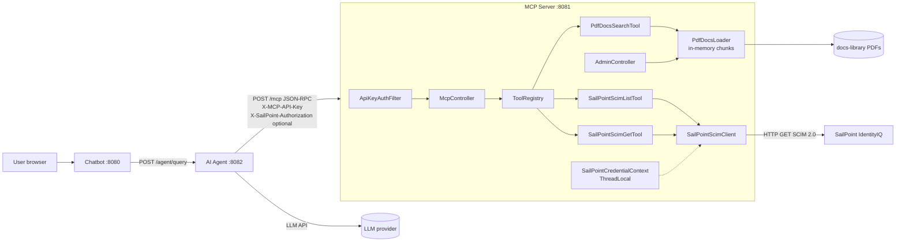
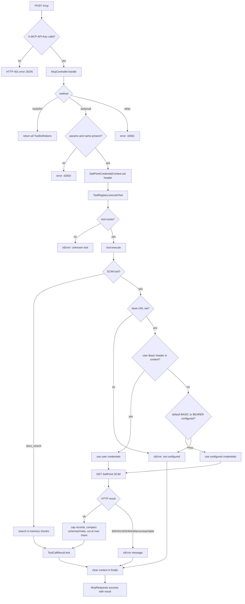
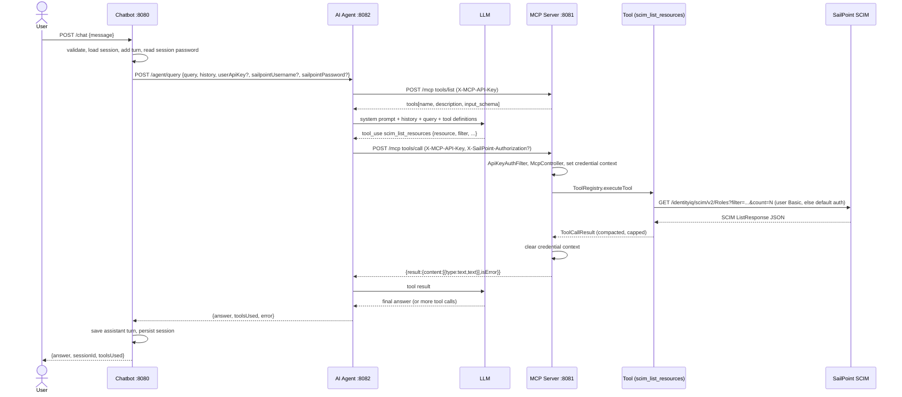

# IAM MCP Server (Component 3 of 3)

Spring Boot service that exposes IAM tools to the AI Agent over a small JSON-RPC 2.0 "MCP" endpoint. It answers
questions from a PDF knowledge base and reads live data from SailPoint IdentityIQ through its SCIM 2.0 API.

| Item | Value |
|---|---|
| Artifact | `com.iam.assistant:mcp-server:1.0.0` |
| Port | `8081` |
| Stack | Java 21, Spring Boot 3.2.5 (web, security, validation, actuator, webflux), Apache PDFBox 3.0.2 |
| Callers | The AI Agent (`mcp-agent`, port 8082) only |
| Calls out to | SailPoint IdentityIQ SCIM 2.0 (`/identityiq/scim/v2/...`) |

The three components:

1. **Chatbot** (`chatbot`, 8080): web UI, login, sessions.
2. **AI Agent** (`mcp-agent`, 8082): LLM tool-calling loop.
3. **MCP Server** (`mcp-server`, 8081): this document.

---

## 1. Component Overview

### Purpose
Give the AI Agent a controlled set of tools it can call: search IAM documentation and query SailPoint. The agent
discovers tools through `tools/list` and runs them through `tools/call`.

### Business and technical responsibilities
- Hold the IAM knowledge base (PDFs), index it in memory and search it on demand.
- Query SailPoint live, read-only, using either the end user's own credentials or a configured service identity.
- Authenticate the calling agent with a shared API key.
- Keep tool output small enough for an LLM (record cap, character cap, noise removed).

### Key functionality
| Tool | What it does |
|---|---|
| `docs_search` | Keyword search with TF-IDF-style scoring over PDF chunks. Returns page references. |
| `scim_list_resources` | Lists any of 14 SailPoint SCIM resource types, with filter, sort and paging. |
| `scim_get_resource` | Fetches one SCIM resource by id (or name). |

Admin endpoints reload and describe the knowledge base.

### Dependencies
| Dependency | Kind | Notes |
|---|---|---|
| AI Agent | Caller | Sends `X-MCP-API-Key` and, optionally, `X-SailPoint-Authorization`. |
| SailPoint IdentityIQ | External system | HTTP, Basic or Bearer auth, base URL from `sailpoint.scim.base-url`. |
| PDF files | Local data | `docs.pdf.directory`, default `classpath:/docs-library` (bundled `IIQ-*.pdf` files). |

---

## 2. Architecture and Design

### High-level architecture



### Internal architecture (layers)
| Layer | Classes |
|---|---|
| Security | `ApiKeyAuthFilter`, `SecurityConfig` |
| Protocol / API | `McpController`, `AdminController`, `GlobalExceptionHandler`, `model.mcp.*` |
| Tool framework | `McpTool`, `ToolRegistry` |
| Tools | `PdfDocsSearchTool`, `SailPointScimListTool`, `SailPointScimGetTool` (+ `ScimResourceCatalog`, `ScimToolSupport`) |
| Services | `PdfDocsLoader`, `SailPointScimClient`, `SailPointCredentialContext` |
| Configuration | `McpServerProperties`, `DocsPdfProperties`, `SailPointScimProperties` |

### Design patterns
- **Registry / plugin**: every `@Component` implementing `McpTool` is auto-registered by `ToolRegistry`.
- **Command-style dispatch**: `McpController` routes a JSON-RPC method to a handler.
- **Static factory + builder**: `McpResponse.success/error`, `ToolCallResult.text/error`, `ToolDefinition.builder()`.
- **Thread-local context**: `SailPointCredentialContext` carries per-request credentials to the client.
- **Atomic snapshot swap**: `PdfDocsLoader` and `PdfDocsSearchTool` hold their index in `AtomicReference`, so reload is hot and thread-safe.
- **Whitelist**: `ScimResourceCatalog` decides which SCIM resources can ever be requested.
- **Servlet filter**: API-key authentication.

### Deployment and hosting
Single executable Spring Boot jar (`spring-boot-maven-plugin`), embedded Tomcat on 8081, stateless apart from the
in-memory PDF index. No container, orchestration or hosting files exist in the repo; hosting is up to you. Run it
close to the agent and keep it off public networks (see Security).

---

## 3. Source Code Structure

```
mcp-server/
├── pom.xml                              Maven build, dependencies
├── logs/                                Runtime log output (LOG_DIR)
└── src/main/
    ├── resources/
    │   ├── application.yml              All configuration
    │   └── docs-library/                IIQ-*.pdf knowledge base + README.txt
    └── java/com/iam/assistant/server/
        ├── McpServerApplication.java    Entry point, @ConfigurationPropertiesScan
        ├── config/                      Security + typed properties
        ├── controller/                  McpController (/mcp), AdminController (/admin)
        ├── exception/                   GlobalExceptionHandler
        ├── model/mcp/                   JSON-RPC and tool payload types
        ├── service/                     PdfDocsLoader, SailPoint client + credential context
        └── tools/
            ├── McpTool.java             Tool contract
            ├── ToolRegistry.java        Discovery and dispatch
            └── impl/                    The concrete tools and SCIM helpers
```

How the modules interact: `McpController` receives a request, `ToolRegistry` finds the tool, the tool uses a
service (`PdfDocsLoader` or `SailPointScimClient`), and the result goes back as `ToolCallResult` inside `McpResponse`.
Properties classes are injected wherever settings are needed.

---

## 4. Class-by-Class Explanation

### `McpServerApplication`
- **Purpose**: Spring Boot entry point; `@ConfigurationPropertiesScan` registers the three properties classes.
- **Methods**: `main(String[])`.
- **Invoked**: at JVM start.

### config package

#### `ApiKeyAuthFilter` (extends `OncePerRequestFilter`)
- **Purpose**: authenticates every request by the `X-MCP-API-Key` header.
- **Key method**: `doFilterInternal(request, response, chain)`.
- **Input**: HTTP request. **Output**: continues the chain with an authenticated principal `mcp-agent` (role `ROLE_MCP_CLIENT`), or writes `401 {"error": "Invalid or missing API key"}` and stops.
- **Details**: skips paths starting with `/actuator/` (it does not authenticate them); compares keys with `MessageDigest.isEqual` (constant time); rejects if the configured key is blank.
- **Dependencies**: expected key from `McpServerProperties` (passed by `SecurityConfig`).
- **Invoked**: on every request, before `UsernamePasswordAuthenticationFilter`.

#### `SecurityConfig`
- **Purpose**: Spring Security setup. CSRF off, stateless sessions, adds the API-key filter.
- **Methods**: `filterChain(HttpSecurity)`, `apiKeyFilter()`.
- **Rules**: `/actuator/health` and `/actuator/info` are open; `/mcp/**` and everything else require authentication.
- **Dependencies**: `McpServerProperties`, `ApiKeyAuthFilter`.

#### `McpServerProperties` (`mcp.server.*`)
- `name`, `version`, `apiKey`, all `@NotBlank` and validated. `api-key` has no default, so startup fails if `MCP_SERVER_API_KEY` is unset.

#### `DocsPdfProperties` (`docs.pdf.*`)
- `directory`, `files` (list of `DocumentConfig{path,label}`), `chunkSize` (800), `chunkOverlap` (150), `maxResults` (5).
- Used by `PdfDocsLoader` and `PdfDocsSearchTool`.

#### `SailPointScimProperties` (`sailpoint.scim.*`)
- Fields: `baseUrl`, `authType` (`BASIC` | `BEARER`), `username`, `password`, `bearerToken`, `basePath`, `maxResponseChars`, `connectTimeoutSeconds` (10), `readTimeoutSeconds` (30), `maxResults`.
- `hasBaseUrl()` is true when the base URL is non-blank.
- Used by `SailPointScimClient` and both SCIM tools. These are the server's **default** credentials, used when the caller sends none.

### controller package

#### `McpController` (`POST /mcp`)
- **Purpose**: the JSON-RPC 2.0 endpoint.
- **Key methods**: `handle(McpRequest, X-SailPoint-Authorization header)`, `handleToolsList`, `handleToolsCall`.
- **Input**: JSON body `{jsonrpc, id, method, params}`; optional header `X-SailPoint-Authorization: Basic ...`.
- **Output**: `McpResponse`. Supported methods: `tools/list`, `tools/call`. Anything else returns error `-32601`.
- **`tools/call`**: validates `params` and `params.name` (`-32602` if missing), logs the tool name and arguments, calls `SailPointCredentialContext.set(header)`, runs `ToolRegistry.executeTool`, and always calls `SailPointCredentialContext.clear()` in `finally`.
- **Invoked**: by the AI Agent for every tool discovery and tool run.

#### `AdminController` (`/admin`)
- **Purpose**: knowledge-base operations.
- **Methods**: `reloadKnowledge()` (`POST /admin/knowledge/reload`): reloads PDFs, rebuilds the IDF index, returns `{status, documentCount, chunkCount, elapsedMs}`. `knowledgeInfo()` (`GET /admin/knowledge/info`): returns `{available, documentCount, chunkCount, documents[{label,chunks}]}`.
- **Dependencies**: `PdfDocsLoader`, `PdfDocsSearchTool`. **Invoked**: manually by an operator (needs the API key).

### exception package

#### `GlobalExceptionHandler` (`@RestControllerAdvice`)
- Maps `MethodArgumentNotValidException` and `IllegalArgumentException` to HTTP 400 with JSON-RPC error `-32602`, and any other `Exception` to HTTP 500 with `-32603` ("Internal server error: <message>").
- **Note**: it only sees exceptions thrown inside controllers. Filter-level failures (bad API key) are handled in the filter.

### model.mcp package

| Class | Role |
|---|---|
| `McpRequest` | Incoming JSON-RPC request: `jsonrpc`, `id` (Object), `method`, `params` (JsonNode). Unknown fields ignored. |
| `McpResponse` | Outgoing envelope `{jsonrpc:"2.0", id, result | error}`. Factories `success(id,result)` and `error(id,code,message)`. Nested `McpError` holds the codes `-32700`, `-32600`, `-32601`, `-32602`, `-32603`. Null fields omitted. |
| `ToolCallResult` | Tool output `{content:[{type:"text",text}], isError}`. Factories `text(String)` and `error(String)`. |
| `ToolDefinition` | Tool description `{name, description, input_schema}` with a builder. Note the snake_case `input_schema` key. |

### service package

#### `PdfDocsLoader`
- **Purpose**: reads PDFs and cuts them into searchable chunks.
- **Key methods**: `init()` (`@PostConstruct`, calls `reload()`), `reload()`, `getChunks()`, `getChunks(labelFilter)`, `isAvailable()`, `getDocumentSummary()`.
- **How it works**: collects PDFs from `docs.pdf.directory` (all `*.pdf`, sorted) plus `docs.pdf.files`, de-duplicated by path. Label is the file name without extension (or the configured label). Text is extracted page by page with PDFBox; a page up to `chunkSize` characters is one chunk, longer pages are split into windows of `chunkSize` with `chunkOverlap` overlap. Missing or unreadable PDFs are logged and skipped. The new list replaces the old one atomically.
- **Output type**: `record DocChunk(source, label, pageNumber, text)`.
- **Invoked**: at startup and by `AdminController.reloadKnowledge`; read by `PdfDocsSearchTool`.

#### `SailPointCredentialContext`
- **Purpose**: thread-local holder of the caller's `Authorization` value.
- **Methods**: `set(String)` (accepts only values starting with `Basic `, otherwise clears), `get()`, `clear()`.
- **Invoked**: set and cleared by `McpController`; read by `SailPointScimClient`. The value is never logged.

#### `SailPointScimClient`
- **Purpose**: the only class that talks to SailPoint.
- **Construction**: if `baseUrl` is blank, no `WebClient` is built. Otherwise a Reactor Netty `WebClient` with connect and read timeouts from the properties and `Accept: application/json`. A default `Authorization` value is prepared from `authType` (Basic from username and password, or Bearer from the token), or `null` if the needed values are blank.
- **Key methods**: `isConfigured()` (true when the client exists **and** either per-request credentials or default credentials are available); `get(basePath, resource, id, query)`: `GET {baseUrl}{basePath}/{resource}[/{id}]?query`, blocking, returns `JsonNode`.
- **Credential order**: thread-local user Basic header, else configured default, else the tool reports "not configured".
- **Safety**: `id` and query values are URI variables, so they are URL-encoded and cannot change the path.
- **Invoked**: by both SCIM tools.

### tools package

#### `McpTool` (interface)
- `getName()`, `getDefinition()`, `execute(JsonNode)` returning `ToolCallResult` (never null; use `ToolCallResult.error` on failure).

#### `ToolRegistry`
- **Purpose**: collects all `McpTool` beans.
- **Methods**: `init()` (builds name-to-tool map, logs registered tools; a duplicate tool name makes startup fail), `listDefinitions()`, `executeTool(name, args)`, `find(name)`.
- **Error handling**: unknown tool returns `ToolCallResult.error("Unknown tool: ...")`; any exception thrown by a tool is caught, logged and returned as an error result.
- **Invoked**: by `McpController`.

### tools.impl package

#### `PdfDocsSearchTool` (`docs_search`)
- **Input**: `query` (required), `document` (optional filter on the document label, case-insensitive substring).
- **Output**: text grouped by document, each hit showing page number, relevance score and up to 450 characters.
- **Scoring**: lower-case, remove punctuation, drop stop words and terms of 2 characters or fewer, expand acronyms (IAM, IDM, IGA, SOD, JML, RBAC, PAM, MFA, SSO, AR, CERT). Score is the sum of `count × IDF` for whole-word matches, plus `+3` when all terms are present, `+4` when all terms fall within 250 characters of the first term, `+10` for an exact phrase. Hits under `3.0` are dropped; the top `docs.pdf.max-results` per document are returned.
- **Methods**: `buildIdfIndex()` (`@PostConstruct`), `rebuildIdfIndex()` (also called by `AdminController`), `execute`.
- **Errors**: blank query, no PDFs loaded, no searchable terms, filter matched nothing.

#### `SailPointScimListTool` (`scim_list_resources`)
- **Input**: `resource` (required), `filter`, `sortBy`, `sortOrder`, `startIndex`, `count`, `attributes`, `excludedAttributes`, `lookupByName`.
- **Logic**: checks `client.isConfigured()`; resolves the resource against the whitelist; for resources not in `NO_QUERY` builds the query (`count` defaults to and is capped at `sailpoint.scim.max-results`, `startIndex` minimum 1, `lookupByName` only for `LOOKUP_BY_NAME` resources); calls the client; trims `Resources` to `max-results` if SailPoint returned more; renders compact JSON.
- **Output**: `=== SAILPOINT <RESOURCE> ===` followed by JSON.

#### `SailPointScimGetTool` (`scim_get_resource`)
- **Input**: `resource`, `id` (both required except `id` for `ServiceProviderConfig`), `attributes`, `excludedAttributes`, `lookupByName`.
- **Logic**: same checks as the list tool; builds `GET /{resource}/{id}`.

#### `ScimResourceCatalog` (package-private)
- Holds `RESOURCES` (14 names, case-insensitive lookup), `NO_QUERY` (`ResourceTypes`, `Schemas`, `ServiceProviderConfig`), `LOOKUP_BY_NAME` (`Alerts`, `Applications`, `ObjectConfigs`, `Roles`, `Users`).
- Methods: `resolve(name)`, `resourceProperty(props)` and `commonQueryProperties(props, list)` (build the JSON schema), `put(...)` (copy a non-blank argument), `compact(node)` (recursively removes every `schemas` and `meta` key), `render(om, node, maxChars)` (compacts, serialises, cuts at `maxChars` and appends a truncation note).

#### `ScimToolSupport` (package-private)
- `call(log, action)` wraps SailPoint calls and turns failures into tool errors: HTTP 400 (filter probably invalid), 401/403 (credentials rejected), 404 (endpoint wrong), other codes (generic message with the code), and connection failures ("Could not reach SailPoint: ...").
- `text`, `line`, `header` are small formatting helpers (currently unused by the remaining tools).

---

## 5. End-to-End Code Flow

### Startup
1. `McpServerApplication.main` starts Spring; the properties classes are bound and validated (missing `MCP_SERVER_API_KEY` stops startup).
2. `PdfDocsLoader.init()` loads and chunks the PDFs.
3. `PdfDocsSearchTool.buildIdfIndex()` builds the IDF index.
4. `SailPointScimClient` is built (or left unconfigured if no base URL).
5. `ToolRegistry.init()` registers the three tools.

### Request lifecycle for `tools/call`



Decision points and error handling:
- Auth failure: HTTP 401 from the filter.
- Unknown JSON-RPC method: error `-32601`. Missing params or name: `-32602`.
- Tool-level failures are **not** JSON-RPC errors; they are `result.isError = true` with a message, so the LLM can read them.
- Unexpected exceptions inside a tool: caught by `ToolRegistry` and returned as `isError`.
- Exceptions outside the tool (for example unparseable JSON body) go to `GlobalExceptionHandler` and return HTTP 500.

---

## 6. Communication Flow Between Components

| Link | Protocol | Auth |
|---|---|---|
| Chatbot → Agent | HTTP REST, JSON (`POST /agent/query`) | none in this repo |
| Agent → MCP Server | HTTP, JSON-RPC 2.0 over `POST /mcp` | `X-MCP-API-Key` shared secret |
| MCP Server → SailPoint | HTTP GET, JSON (SCIM 2.0) | `Authorization: Basic` (user's or configured) or `Bearer` (configured) |

Agent → MCP Server payloads (this component's interface):

```json
POST /mcp
X-MCP-API-Key: <shared key>
{"jsonrpc":"2.0","id":1,"method":"tools/list","params":{}}
```
```json
{"jsonrpc":"2.0","id":1,"result":{"tools":[{"name":"docs_search","description":"...","input_schema":{"type":"object","properties":{...},"required":["query"]}}]}}
```
```json
POST /mcp
X-MCP-API-Key: <shared key>
X-SailPoint-Authorization: Basic <base64 user:password>      (optional)
{"jsonrpc":"2.0","id":2,"method":"tools/call","params":{"name":"scim_list_resources","arguments":{"resource":"Roles","filter":"name co \"Manager\"","count":20}}}
```
```json
{"jsonrpc":"2.0","id":2,"result":{"content":[{"type":"text","text":"=== SAILPOINT ROLES ===\n{...}"}],"isError":false}}
```

Authentication and authorization: the API key proves the caller is the agent. Authorization to SailPoint data is whatever the SailPoint account in use is allowed to see. The MCP server itself has no per-user or per-tool authorization.

---

## 7. Chatbot → AI Agent → MCP Server Flow

### Chatbot layer
- The user logs in at `/login`; the chatbot checks the password against its own `users.json` (BCrypt) and stores the login password in the server-side HTTP session for SailPoint forwarding.
- `POST /chat` with `{message, sessionId?}` is validated (`message` not blank), the conversation is loaded or created per user, the user turn is added, and history (all earlier turns) is sent along.
- It builds the agent payload `{query, sessionId, history, userApiKey?, sailpointUsername?, sailpointPassword?}`. `userApiKey` is sent only if the user has an LLM token; the SailPoint login is sent only if the session still holds the password.

### AI Agent layer
- `POST /agent/query` → `AgentOrchestrationService.process`.
- It calls `tools/list` on this server, wraps each tool as a Spring AI `ToolCallback`, builds a chat model (user token, else the agent's configured `api-key`), uses the system prompt and the history, and lets the LLM choose tools (limited by `max-tool-iterations`).
- Each tool call becomes `tools/call` on this server; the user's SailPoint login goes in `X-SailPoint-Authorization` as `Basic base64(user:password)`.

### MCP Server layer
- Discovery: `ToolRegistry` returns the `ToolDefinition` of every registered tool.
- Execution: filter → controller → context set → registry → tool → client → SailPoint → result → context cleared → `McpResponse`.
- Return path: the agent reads `result.content[0].text` and gives it to the LLM, which writes the final answer.

### Complete trace



---

## 8. APIs and Interfaces

All endpoints (except `/actuator/health` and `/actuator/info`) need the header `X-MCP-API-Key`.

| Method | Path | Purpose |
|---|---|---|
| POST | `/mcp` | JSON-RPC: `tools/list`, `tools/call` |
| POST | `/admin/knowledge/reload` | Reload PDFs and rebuild the index |
| GET | `/admin/knowledge/info` | Knowledge base summary |
| GET | `/actuator/health`, `/actuator/info` | Health and info, no key needed |

Note: the `initialize` and `ping` methods are **not** implemented (`ping` is commented out in the code); they return `-32601`.

### Tools

**`docs_search`**: `{"query":"access request approval process","document":"lifecycle"}`.

**`scim_list_resources`**: `{"resource":"Users","filter":"active eq true","sortBy":"userName","sortOrder":"ascending","startIndex":1,"count":50,"attributes":"id,userName","excludedAttributes":"","lookupByName":false}`.

**`scim_get_resource`**: `{"resource":"Roles","id":"Manager","lookupByName":true}`.

### SCIM coverage (22 read endpoints from the Postman collection)

| Resource | List | Get by id |
|---|---|---|
| Accounts | yes | yes |
| Alerts | yes | yes |
| Applications | yes | yes |
| Entitlements | yes | yes |
| LaunchedWorkflows | yes | yes |
| ObjectConfigs | yes | yes |
| PolicyViolations | yes | yes |
| ResourceTypes | yes | yes |
| Roles | yes | yes |
| Schemas | yes | yes |
| ServiceProviderConfig | yes | (no id) |
| TaskResults | yes | yes |
| Users | yes | yes |
| Workflows | yes | yes |

Rules: `ResourceTypes`, `Schemas`, `ServiceProviderConfig` send no query parameters; `lookupByName` only goes out for `Alerts`, `Applications`, `ObjectConfigs`, `Roles`, `Users`; `count` is capped at `sailpoint.scim.max-results`; output is cut at `sailpoint.scim.max-response-chars`; `schemas` and `meta` keys are removed.

Assumption to verify: the Postman collection uses singular paths for get-by-id of LaunchedWorkflows and ObjectConfigs; the code uses the plural names for all resources.

**Deliberately not implemented** (they change data): create, update and delete for Users and Accounts, create Alert, and `CheckedPolicyViolations` (POST). The server has no write tool.

### Error codes
| Situation | Where | Result |
|---|---|---|
| Missing or wrong API key | filter | HTTP 401 `{"error":"Invalid or missing API key"}` |
| Unknown JSON-RPC method | controller | `-32601` |
| Missing `params` or `name` | controller | `-32602` |
| Bad request body or unhandled exception | `GlobalExceptionHandler` | HTTP 500 (or 400), `-32603` / `-32602` |
| Unknown tool, bad arguments, not configured | tool | `isError: true` with a message |
| SailPoint 400 / 401, 403 / 404 / other / unreachable | `ScimToolSupport.call` | `isError: true` with a matching message |

### External integration
SailPoint IdentityIQ SCIM 2.0 only. No database, queue or other service.

---

## 9. Configuration and Environment Setup

### Environment variables
| Variable | Default | Meaning |
|---|---|---|
| `MCP_SERVER_API_KEY` | none (required) | Shared key the agent must send |
| `SAILPOINT_SCIM_BASE_URL` (fallback `SAILPOINT_BASE_URL`) | built-in default in the yml (see risk below) | SailPoint base URL |
| `SAILPOINT_SCIM_AUTH_TYPE` | `BASIC` | `BASIC` or `BEARER` |
| `SAILPOINT_SCIM_USERNAME` / `SAILPOINT_SCIM_PASSWORD` (fallbacks `SAILPOINT_USERNAME` / `SAILPOINT_PASSWORD`) | built-in defaults in the yml | Default Basic credentials |
| `SAILPOINT_SCIM_BEARER_TOKEN` | empty | Default Bearer token |
| `SAILPOINT_SCIM_BASE_PATH` | `/identityiq/scim/v2` | SCIM root |
| `SAILPOINT_SCIM_MAX_RESULTS` | `50` | Records per call |
| `SAILPOINT_SCIM_MAX_RESPONSE_CHARS` | `20000` | Characters per response |
| `DOCS_PDF_DIRECTORY` | `classpath:/docs-library` | PDF folder (`file:/...` or `classpath:`) |
| `LOG_DIR`, `LOG_MAX_FILE_SIZE`, `LOG_MAX_HISTORY`, `LOG_TOTAL_SIZE_CAP` | `./logs`, `10MB`, `30`, `1GB` | Logging |

Other settings in `application.yml` without env override: port 8081, `docs.pdf.chunk-size` 800, `chunk-overlap` 150, `max-results` 5, SailPoint connect and read timeouts (10 s and 30 s, set only through properties).

### Secrets
Secrets come from environment variables. **Risk**: `application.yml` ships with real-looking fallback values for the SailPoint address and the SailPoint account name and password. Remove those defaults and supply them through environment variables or a secret store before sharing or deploying this code.

### Build and run
```bash
mvn -f mcp-server/pom.xml clean package
MCP_SERVER_API_KEY=<key> SAILPOINT_SCIM_BASE_URL=<url> SAILPOINT_SCIM_USERNAME=<user> SAILPOINT_SCIM_PASSWORD=<pw> \
  java -jar mcp-server/target/mcp-server-1.0.0.jar
```
The agent must be configured with the same key (`MCP_SERVER_API_KEY`) and this server's URL (`MCP_SERVER_URL`).

Note: the default `classpath:/docs-library` is read through `Resource.getFile()`, which works when running from an exploded directory but not from inside a packaged jar. For the jar, set `DOCS_PDF_DIRECTORY=file:/path/to/pdfs`.

---

## 10. Logging, Monitoring and Troubleshooting

- **Framework**: Spring Boot default (SLF4J + Logback). Console and file `${LOG_DIR:./logs}/iam-mcp-server.log`, rolling by size (10 MB), 30 days, 1 GB total.
- **Levels**: `com.iam.assistant` INFO, `org.springframework.web` OFF.
- **What is logged**: tool name and arguments (`Executing tool: ... with args: ...`), per-tool lines, SailPoint HTTP status warnings, PDF index statistics. Passwords and the `Authorization` value are not logged by this code. Tool arguments are logged, so avoid putting secrets into them.
- **Monitoring**: `/actuator/health` and `/actuator/info` are public. `metrics` is listed for exposure but, because the API-key filter skips `/actuator/` and authenticates nothing there, it is effectively unreachable. No alerting is configured.

| Symptom | Likely cause | Fix |
|---|---|---|
| Startup fails with a property error | `MCP_SERVER_API_KEY` not set | Set it |
| Agent gets 401 | Key mismatch | Use the same key on both sides |
| "SCIM integration is not configured" | No base URL, or no user credentials and no default credentials | Set `SAILPOINT_SCIM_*` or log in through the chatbot |
| "credentials rejected (HTTP 401/403)" | Wrong SailPoint login; chatbot password differs from SailPoint's | Fix credentials; user's login is tried first, then not retried with the default |
| "HTTP 400 ... filter" | Invalid SCIM filter | Fix filter or drop it |
| "HTTP 404" | Wrong base path or resource path | Check `base-path`, resource name |
| "Could not reach SailPoint" | Network, timeout (30 s) | Check connectivity and `read-timeout` |
| `docs_search` says no PDFs loaded | Directory missing, or running from a jar with the classpath default | Set `DOCS_PDF_DIRECTORY`, then `POST /admin/knowledge/reload` |
| Output ends with "[truncated: ...]" | Response exceeded `max-response-chars` | Narrow with `filter`, `attributes`, `count` |

---

## 11. Security Considerations

- **Authentication to this server**: shared API key in `X-MCP-API-Key`, constant-time compare. One key for all callers; no rotation mechanism.
- **User identity to SailPoint**: the chatbot's login password is forwarded (via the agent) as a Basic header and used for that one tool call. Without it, the configured service account is used, so every user then sees what that account sees.
- **Token handling**: the credential is held in a thread-local only while the tool runs and removed in `finally`; it is not logged or stored.
- **Input safety**: SCIM resource names are whitelisted; ids and query values are URL-encoded; only GET requests are made.
- **Data protection**: no encryption at rest (nothing sensitive is stored). **No TLS is configured on this server**; the default hops are plain HTTP, so the SailPoint password and the API key travel in clear text unless TLS is added in front or on the SailPoint URL. Use HTTPS for `sailpoint.scim.base-url` and TLS between agent and server.
- **CSRF** is disabled and sessions are stateless (appropriate for an API-key service).

---

## 12. Missing Information / Frequently Overlooked Areas

| Area | Current state |
|---|---|
| Error handling | Tool errors become `isError` results; JSON-RPC errors for protocol faults. Malformed JSON bodies end as HTTP 500 rather than `-32700`; a request without `method` would fail with a server error. |
| Retry and resiliency | **None.** No retry, circuit breaker or fallback for SailPoint calls. |
| Timeouts | SailPoint: connect 10 s, read 30 s. Agent-to-server timeouts are set in the agent. |
| Scalability | Stateless apart from the in-memory PDF index, so it can run in several instances; each loads its own copy of the PDFs and `reload` must be called on each. Calls to SailPoint block a Tomcat thread (`block()`). |
| Load balancing | None built in; use an external balancer if needed. |
| Caching | None for SailPoint data. The PDF index is the only in-memory store. |
| Rate limiting | **None.** An authenticated caller can issue unlimited requests. |
| Failover | None. If SailPoint is down, tools return errors. |
| Data persistence | No database. PDF index is rebuilt at startup; logs go to disk. |
| Observability and tracing | Logs only. No correlation id, no distributed tracing; `metrics` effectively unreachable; no audit log of who called what. |
| Authorization | No per-user or per-tool authorization in this server. |
| Security gaps | Hard-coded fallback SailPoint address and credentials in `application.yml`; single shared API key; no TLS; password forwarded across two internal hops; tool arguments logged. |
| Stale text | The `scim_list_resources` description still mentions `get_sailpoint_users` and `get_sailpoint_entitlements`, which no longer exist. Those tools were removed. |
| Tests | No test classes exist in this module. |

### How to add a tool
1. Create a class in `tools/impl` annotated `@Component` that implements `McpTool`.
2. `getName()`: unique snake_case name (a duplicate stops startup).
3. `getDefinition()`: description and JSON-schema `ObjectNode` built with `ToolDefinition.builder()`.
4. `execute(JsonNode)`: validate arguments, do the work, return `ToolCallResult.text(...)` or `ToolCallResult.error(...)`.
5. Restart. `ToolRegistry` picks it up and `tools/list` returns it. Mention the tool in the agent's system prompt so the LLM knows when to use it.

---

## Overall Architecture Summary

1. The user logs in to the **Chatbot**, which validates the account and keeps the password in the session. A chat message is validated, added to the user's conversation and sent with its history to the **AI Agent**, along with an optional LLM token and the user's SailPoint login.
2. The **AI Agent** fetches the tool list from the **MCP Server**, builds the model (user token or its own key), and runs the LLM tool-calling loop under the system prompt.
3. Each tool the LLM picks becomes a `tools/call` request to the **MCP Server**, authenticated by the shared API key and carrying the user's SailPoint login if present.
4. The **MCP Server** runs the tool: `docs_search` over the in-memory PDF index, or a read-only SCIM call to **SailPoint** using the user's credentials, falling back to the configured BASIC or BEARER ones. The result is capped, stripped of noise and returned as text.
5. The agent gives the result back to the LLM, which may call more tools, then returns the final answer. The chatbot stores the turn and replies to the user.

Failures surface as readable tool errors, so the LLM can tell the user what went wrong. The main gaps to close before production are TLS between services, removal of hard-coded defaults, retries, rate limiting and tracing.
